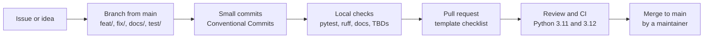

# Contributing to Cluster Review Intelligence

Thank you for your interest in contributing. This project produces statistical
claims that people may act on, so contributions are held to two standards above all
others: **honesty** (no claim without evidence) and **reproducibility** (anyone can
regenerate every number).

By participating you agree to follow the [Code of Conduct](CODE_OF_CONDUCT.md).

## Contents

1. [Ground rules](#1-ground-rules)
2. [Ways to contribute](#2-ways-to-contribute)
3. [Development setup](#3-development-setup)
4. [Workflow](#4-workflow)
5. [Coding standards](#5-coding-standards)
6. [Testing](#6-testing)
7. [Documentation and results](#7-documentation-and-results)
8. [Pull requests](#8-pull-requests)
9. [Extending the system](#9-extending-the-system)
10. [Reporting issues and vulnerabilities](#10-reporting-issues-and-vulnerabilities)
11. [License of contributions](#11-license-of-contributions)

## 1. Ground rules

These rules are non-negotiable and are checked in review.

| Rule | What it means in practice |
|---|---|
| Never fabricate results | No invented accuracy, F1, dataset sizes, quotes or statistics in code, docs or figures. Unknown values are written as `TBD` and listed in [`docs/TODO_RESULTS.md`](docs/TODO_RESULTS.md). |
| Label synthetic data | Synthetic data carries `SYNTHETIC` (or `synthetic`) in filenames, figures and captions. |
| No scraping | Ingestion reads CSV/JSON files the team provides. Do not scrape platforms or bypass blocks, rate limits or logins. |
| No personal data | Reviewer names and IDs are dropped at ingestion. Real properties are anonymised (Property A, B, ...) in anything public. Never attach real reviews to issues or pull requests. |
| No secrets in git | Configuration is via environment variables; keep `.env.example` current. |
| Licensed assets only | No images of real hotels unless licensed; record every asset in [`docs/CREDITS.md`](docs/CREDITS.md). |

## 2. Ways to contribute

- **Labelled data and evaluation.** Hand-labelled real reviews are the most valuable
  contribution: they turn the `TBD` accuracy figures into measured ones. Follow
  [`eval/labeling_guidelines.md`](eval/labeling_guidelines.md).
- **Language coverage.** Extend the aspect cue terms and the sentiment lexicon for
  Hinglish and Devanagari, with tests for each new pattern.
- **Statistics.** Improve detectors with calibration evidence on null and injected
  data (see [`docs/methodology.md`](docs/methodology.md)).
- **Web app and API.** Improve the Next.js app (`web/`) or the FastAPI service
  (`src/cri/server.py`).
- **Documentation.** Fix inaccuracies, clarify methods, add worked examples.

For larger changes, open an issue first to agree on the approach.

## 3. Development setup

Requirements: Python 3.11 or 3.12, and Node.js 22 for `web/`.

```bash
git clone https://github.com/PxA-Labs/cluster-review-intelligence.git
cd cluster-review-intelligence
python -m pip install -e ".[dev,api]"

python -m pytest           # all tests, including the HTTP API via TestClient
python -m ruff check .     # lint
```

Next.js frontend:

```bash
python web/scripts/export_snapshot.py   # regenerate the SYNTHETIC snapshots
cd web && npm ci && npx tsc --noEmit && npm run build
```

Optional sentiment backends:

```bash
# learned backend: the packaged open-data model, no extra install for inference
CRI_MODEL_BACKEND=learned python scripts/demo.py
# re-train it (data downloads: docs/DATA_SOURCES.md)
python -m pip install -e ".[train]"
python scripts/train_sentiment.py --model open

# transformer backend (downloads a model of about 541 MB on first use)
python -m pip install -e ".[model]"
CRI_MODEL_BACKEND=transformer python scripts/demo.py
```

## 4. Workflow



- **Branches.** Branch from `main` using a type prefix, for example
  `feat/intervention-check` or `fix/ingest-dates`. Never push to `main` directly.
- **Commits.** Keep them small and focused, with
  [Conventional Commits](https://www.conventionalcommits.org/) messages:
  `feat:`, `fix:`, `docs:`, `test:`, `refactor:`, `perf:`, `chore:`, optionally
  scoped, for example `fix(classify): keep the aspect after a bare 'but' clause`.
- **Staying current.** Rebase on `main` before opening and before updating a pull
  request: `git pull --rebase origin main`.

## 5. Coding standards

- **Python.** Type hints, the `src/` layout, and `ruff` clean (the configuration is in
  `pyproject.toml`). Match the surrounding code's naming, comment density and idiom.
- **Interface boundaries.** The web app reaches Python only through the HTTP API
  (`cri.server`, documented in [`docs/API_CONTRACTS.md`](docs/API_CONTRACTS.md)) and
  the snapshots exported from the facade `cri.api` (contract in
  [`docs/HACKATHON_PLAN.md`](docs/HACKATHON_PLAN.md) section 3.2). Changes to either
  are additive; never remove or rename a documented endpoint, function or column, and
  update `docs/API_CONTRACTS.md` with every endpoint change.
- **Dependencies.** Pin exact versions. Prefer releases that are at least two weeks
  old. GitHub Actions are pinned to full commit SHAs looked up from the official
  action repositories, never guessed.
- **Statistics.** Every significance decision must be controlled for multiple
  testing where several tests are made, documented in `docs/methodology.md`, and
  calibrated on both injected and null SYNTHETIC data.
- **Reproducibility.** Random processes are seeded. Figures come from
  `scripts/make_figures.py`, never edited by hand.

## 6. Testing

| Change | Expected tests |
|---|---|
| New or changed detector | Recovery on injected data, silence on null data, fixed seeds in `tests/sim_helpers.py` |
| Classifier or lexicon | Positive and negative examples per new pattern, including Hinglish and Devanagari |
| `cri.api` | Contract tests in `tests/test_api.py`: documented columns and `ValueError` on bad input |
| HTTP API endpoint | Request and response tests in `tests/test_server.py` |
| Web page | `npx tsc --noEmit` and `npm run build` in `web/` pass (CI runs both) |
| Number quoted in docs | A test that pins it, so the docs cannot drift from the code |

CI runs `ruff` and `pytest` on Python 3.11 and 3.12, and type-checks and builds the
web app on Node.js 22, for every pull request.

## 7. Documentation and results

A change is **done** only when:

1. tests pass and `ruff` is clean;
2. the README and the relevant docs are updated;
3. every new number is reproducible from a command in the repository;
4. no `TBD` has been replaced by a made-up value. A real measured value replaces a
   `TBD` in [`docs/TODO_RESULTS.md`](docs/TODO_RESULTS.md) **and** everywhere it is
   cited.

## 8. Pull requests

- Use the pull request template and complete its checklist.
- Describe what changed, why, and how it was verified, including commands and
  results. State what was **not** verified.
- Link related issues (`Closes #123`).
- Keep pull requests focused. Split refactors from behaviour changes so that a
  refactor can be shown to change nothing.
- A maintainer merges after review and green CI.

## 9. Extending the system

### Adding a classifier backend

1. Implement the `Classifier` interface in `src/cri/classify.py` and register it in
   `get_classifier` behind a `CRI_MODEL_BACKEND` value. The default must stay `rule`.
2. Keep heavy dependencies in an optional extra in `pyproject.toml`. Model weights
   are pinned to a fixed revision and loaded without executing pickled code.
3. Evaluate it against the rule baseline with `eval/predict.py` and `eval/score.py`
   on held-out real labelled data, and report both results. Make it the default only
   if it wins.

### Adding a data source

Map new export formats through `src/cri/sources.py` (aliases or a YAML mapping)
rather than changing the schema. Identity fields must still be dropped at ingestion.

### Adding an analysis

Implement it in the core, expose it through `cri.api` as an additive extension, add
calibration on SYNTHETIC data, and document the method and its limitations in
`docs/methodology.md`.

## 10. Reporting issues and vulnerabilities

- **Bugs and feature requests:** open an issue using the templates in
  `.github/ISSUE_TEMPLATE/`. Reproduce problems with the SYNTHETIC sample, never with
  real data.
- **Security vulnerabilities:** report privately as described in
  [`SECURITY.md`](SECURITY.md). Do not open a public issue.
- **Conduct concerns:** see the enforcement section of the
  [Code of Conduct](CODE_OF_CONDUCT.md).

## 11. License of contributions

This project is licensed under the [Apache License, Version 2.0](LICENSE). Unless you
state otherwise, any contribution you intentionally submit for inclusion is licensed
under the same terms, as described in section 5 of the license.
