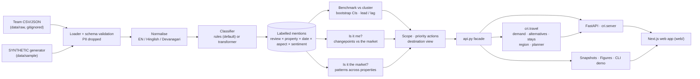
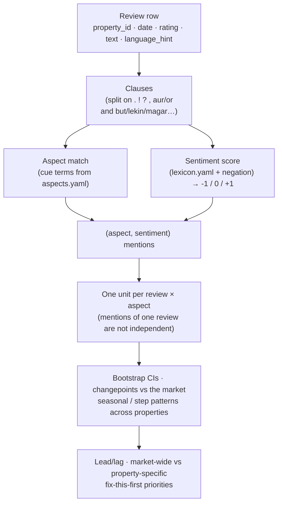
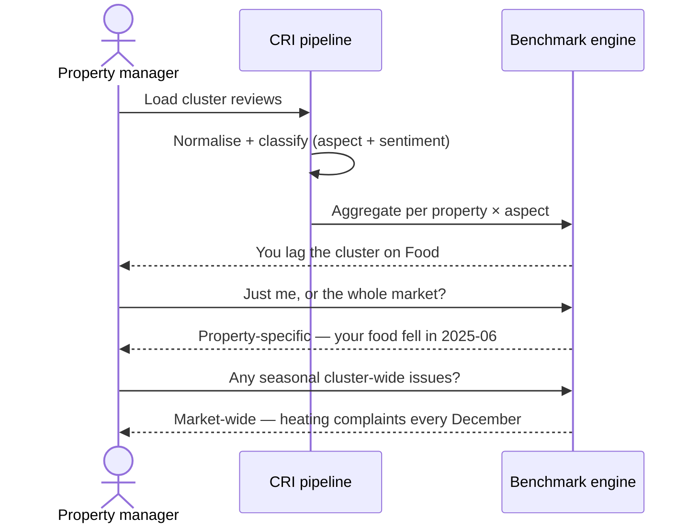
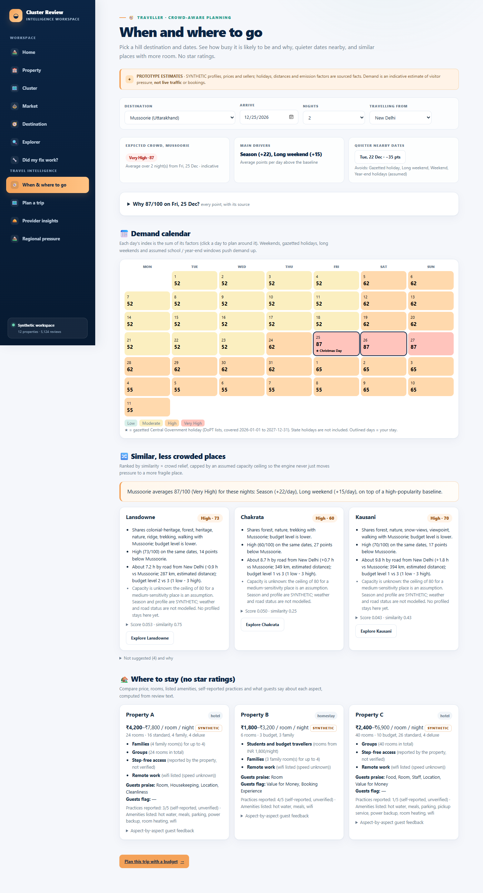

# Cluster Review Intelligence

> Turn a cluster's raw tourist reviews into **aspect-level**, **competitive**,
> **time-aware** intelligence — tell a property manager whether a problem is
> *theirs* or the *whole market's* — and put that evidence to work for travellers,
> providers, local sellers and tourism boards in Uttarakhand and Himachal hill
> destinations.

[](https://github.com/PxA-Labs/cluster-review-intelligence/actions/workflows/ci.yml)
[](LICENSE)
[](https://securityscorecards.dev/viewer/?uri=github.com/PxA-Labs/cluster-review-intelligence)

<sub>AI–Tourism Hackathon 2026 · Problem statement **G5 — Cluster Review Intelligence & Competitive Benchmarking** · The Scorecard badge populates after the first run on the public repository. Review data, stays, prices and sellers are **SYNTHETIC**; holidays, distances, arrivals and emission factors are sourced facts ([`docs/DATA_SOURCES.md`](docs/DATA_SOURCES.md)).</sub>

---

## The problem: "4.1" means different things in different markets

A single average rating hides almost everything a property manager needs.

- A property can sit at **4.1★** while its *food* sentiment is quietly collapsing —
  masked by strong *location* and *staff* scores.
- A dip in *room* sentiment every winter might not be a failing of **your** hotel
  at all — if **every** property in the cluster gets cold-room complaints each
  December, that is a **destination-level** issue, not a competitive gap.

Managers don't need another star average. They need: *on which aspect am I behind
my cluster, since when, and is it just me or everyone?*

This project answers exactly that, from review text — including the
**Hinglish / Devanagari / English** mix real Uttarakhand reviews are written in.

## Who it is for

- **Property managers** — see where you lead or lag the cluster, per aspect, and
  whether a decline is yours or market-wide.
- **Tourism boards / DMOs** — a destination view: which issues move together across
  the whole cluster and when (e.g. seasonal), to target interventions; plus expected
  visitor pressure against assumed capacity ceilings and where to redistribute it.
- **Travellers** (students, families, budget travellers) — holiday-aware crowd
  estimates, quieter dates, similar less-crowded places, stays compared **without
  star ratings**, and a budget trip plan with local sellers and a carbon estimate.
- **Accommodation providers** — explained priorities from reviews, demand peaks
  against their room mix, amenity gaps and quiet windows for offers.
- **Local sellers** (artisans, weavers, guides; not restaurants) — discovered inside
  trip plans; tourism boards see which categories are under-served.

## What it does today (MVP)

| Capability | Status | Where |
|---|---|---|
| Schema + CSV/JSON loader, **PII dropped at ingestion** | ✅ | `src/cri/loader.py`, `src/cri/schema.py` |
| **SYNTHETIC** data generator (12 properties, injected patterns) | ✅ | `src/cri/generate.py` |
| Text normalisation (EN / Hinglish / Devanagari, emoji, negation) | ✅ | `src/cri/normalize.py` |
| Aspect taxonomy + sentiment lexicon as **validated config** | ✅ | `src/cri/resources/aspects.yaml`, `lexicon.yaml` |
| Transparent **rule/lexicon** aspect + sentiment classifier | ✅ | `src/cri/classify.py` |
| Optional **multilingual transformer** sentiment backend (`CRI_MODEL_BACKEND=transformer`) | ✅ (opt-in) | `src/cri/transformer_backend.py` |
| Cluster benchmark with **review-level bootstrap 95% CIs**; lead/lag flags FDR-controlled across the cluster | ✅ | `src/cri/benchmark.py` |
| **"Is it me?"** — significance-tested changepoints *relative to the market* (FDR-controlled) | ✅ | `src/cri/benchmark.py`, `changepoint.py` |
| **"Is it the market?"** — seasonal dips (any month) and step declines tested *across properties* | ✅ | `src/cri/benchmark.py` |
| **Market-wide vs property-specific** scope, `undetermined` when under 3 properties review an aspect | ✅ | `src/cri/benchmark.py` |
| **"Did my fix work?"** — before/after of a change the property made, *relative to the market* (difference-in-differences against the cluster), with placebo check, timing check and minimum detectable effect | ✅ | `src/cri/intervention.py` |
| **"Fix this first"** priority actions (works even for a single-hotel upload) + tourism-board **destination view** | ✅ | `src/cri/insights.py` |
| Stable **API facade** for the dashboard (contract in `docs/HACKATHON_PLAN.md` §3.2); normalises messy exports (numeric ids, timezone-stamped dates) | ✅ | `src/cri/api.py` |
| **Reproducible calibration**: recall and false-alarm rates on SYNTHETIC data | ✅ | `python -m cri.calibration` |
| Reproducible figures from synthetic data | ✅ | `scripts/make_figures.py` |
| **Next.js web app** (the only UI): property view, heatmap, market quadrant, destination view, review explorer with live *Try your own review*, *Did my fix work?*; SYNTHETIC banner, CSV export | ✅ | `web/` |
| **HTTP API** (FastAPI) for the web app: review core + travel layer, validated inputs, CORS | ✅ | `src/cri/server.py` |
| **Holiday-aware demand index** (0–100, every point explained): DoPT gazetted holidays 2026–27, long weekends, assumed school / year-end windows, quieter dates, regional overview — an estimate, *not* live traffic | ✅ | `src/cri/travel/demand.py` |
| **Crowd-aware alternatives**: similarity × crowd relief with a capacity guard and five-part explanations | ✅ | `src/cri/travel/alternatives.py` |
| **Star-free stay profiles** + **provider insights** (review priorities, amenity gaps, peaks vs room mix, offer windows) | ✅ | `src/cri/travel/stays.py` |
| **Local sellers**, seller-category opportunity (labelled "not sales") and the **tourism-board region view** | ✅ | `src/cri/travel/region.py` |
| **Trip planner**: itinerary, traced costs, car vs bus carbon from sourced factors, cheaper / quieter variants | ✅ | `src/cri/travel/planner.py` |
| **Learned sentiment backend** trained on open Hinglish data (+ a local model on hill-destination reviews), measured on held-out data | ✅ (opt-in) | `src/cri/learned_backend.py`, `scripts/train_sentiment.py` |
| Partner exports with other column names (aliases or a YAML mapping) | ✅ | `src/cri/sources.py` |
| **Evaluation harness**: export predictions, then aspect P/R/F1 + sentiment macro-F1, confusion matrix, error analysis | ✅ | `eval/predict.py`, `eval/score.py` |
| Tests: pattern recovery, null-data silence, API contract, HTTP API, travel invariants, learned-model parity, demo claims; CI also type-checks and builds the web app | ✅ | `tests/`, `.github/workflows/ci.yml` |
| Accuracy on **real** hand-labelled reviews | ⏳ `TBD` | needs the labelled set |

The aspect taxonomy is **Food, Room, Housekeeping, Staff, Location, Value for
Money, Cleanliness, Booking Experience**.

## Architecture



Full design, data flows and trade-offs: [`docs/SYSTEM_DESIGN.md`](docs/SYSTEM_DESIGN.md).

### Data flow



### Analyst journey



## Quickstart (under 5 minutes)

Prerequisites: Python 3.11 or 3.12, Node 22. No database, no secrets.

```bash
git clone https://github.com/PxA-Labs/cluster-review-intelligence.git
cd cluster-review-intelligence
python -m pip install -e ".[dev,api]"

python -m pytest                          # 1) tests (patterns, API, travel invariants)
uvicorn cri.server:app --port 8000        # 2) the API (terminal 1; docs at /docs)
cd web && npm ci && npm run dev           # 3) the web app at http://localhost:3000 (terminal 2)
python scripts/demo.py                    # 4) every number the G5 demo quotes
python scripts/make_figures.py            # 5) regenerate the figures below (docs/img/)
python -m cri.calibration --seeds 1-20    # 6) recall / false-alarm rates (about a minute)
```

The G5 pages read a committed snapshot (`web/public/data/*.synthetic.json`) and work
without the API; the travel pages and *Try your own review* need it. The web app
finds the API at `NEXT_PUBLIC_API_BASE_URL` (default `http://localhost:8000`, read at
build time; see `web/.env.example`), and the API accepts browser calls from
`CRI_API_CORS_ORIGINS` (default `http://localhost:3000`; see `.env.example`).

`scripts/demo.py` prints, from the SYNTHETIC sample, the facts the judge demo
([`docs/DEMO.md`](docs/DEMO.md)) relies on, including `Property F` food declining
from `2025-06` (property-specific) and cluster-wide December room complaints
(market-wide). The full-product demo is [`docs/DEMO_SCRIPT.md`](docs/DEMO_SCRIPT.md);
deployment: [`docs/DEPLOYMENT.md`](docs/DEPLOYMENT.md).

> Windows without `make`: run the commands above directly (the `Makefile` just
> wraps them).

## Web app (SYNTHETIC data)




More pages, all on SYNTHETIC data:
[trip planner](docs/screenshots/plan_SYNTHETIC.png) ·
[provider insights](docs/screenshots/provider_SYNTHETIC.png) ·
[regional pressure](docs/screenshots/region_SYNTHETIC.png) ·
[market quadrant](docs/screenshots/market_quadrant_SYNTHETIC.png) ·
[review explorer](docs/screenshots/review_explorer_SYNTHETIC.png).
Deep links: `/property/?property=Property%20F`,
`/explore/?destination=mussoorie&start=2026-12-25&nights=2`.

## Figures (SYNTHETIC data)

| Aspect benchmark — a property vs its cluster | Cluster heatmap — property × aspect |
|---|---|
|  |  |

| Trend + changepoint | Market-wide vs property-specific |
|---|---|
|  |  |

All four are regenerated by `scripts/make_figures.py` from `seed=42`. They depict
**SYNTHETIC** data, not real properties.

## Methodology (summary)

Transparent by default (rules + a multilingual lexicon), with every statistical
claim tested rather than thresholded.

- **Aspects** via cue terms in `aspects.yaml`; **sentiment** via `lexicon.yaml`
  (EN + romanised Hindi + Devanagari) with negation handling → −1 / 0 / +1 per clause.
- **Unit of analysis:** one value per (review, aspect). Mentions from one review
  are correlated, so counting them separately overstated the evidence.
- **Lead / lag:** significant after Benjamini–Hochberg across every
  property-aspect pair, and the review-level bootstrap 95% CI must exclude the
  cluster mean (≥ 10 reviews, gap > 0.05).
- **"Is it me?"** A property's sentiment *minus the rest of the market* is tested
  for a step change. The market is built from the other properties' deviations
  from their own levels, so hotels entering or leaving the data do not move it.
  t-test with an exact Student-t tail, Bonferroni over splits, Benjamini–Hochberg
  at 5% FDR across series, effect floor 0.4.
- **"Is it the market?"** Properties are the replicates: a dip in any calendar
  month must recur within every observed year, and a step decline must be shared
  (t-test, BH at 5%, and ≥ 60% of properties dropping by ≥ 0.3).
- **Fix this first:** gap to the cluster over the same months × share of mentions.
- **Did my fix work?** The property's change since the month it acted, minus the
  market's change over the same months (one pre-specified test). "Before" starts
  at the latest significant shift, so a fix after a decline is judged against the
  declined level. Reports a placebo rank among the other properties and the
  smallest change the data could detect.

Full details, exact thresholds and their justification:
[`docs/methodology.md`](docs/methodology.md).

## Travel intelligence (summary)

Transparent engines, because there is no footfall or booking data to train on.
Every number they return carries its **basis**: `fact` (cited source), `measured`,
`derived`, `synthetic` or `assumption`.

- **Demand index** = popularity tier + season + weekend + gazetted holiday + long
  weekend + assumed school / year-end window, clipped to 0–100. The index always
  equals the sum of the factors shown. Low < 30 ≤ Moderate < 55 ≤ High < 75 ≤ Very
  High. Holidays come from the DoPT lists for 2026–27; state holidays and live
  traffic are not modelled.
- **Alternatives** = similarity (landscape, activities, budget, travel time, season)
  × min(crowd relief, capacity headroom), with **assumed** ceilings by environmental
  sensitivity. No official carrying capacity exists for these places.
- **Stays** are compared on price, rooms, self-reported amenities and practices, and
  aspect-level guest feedback from the review core, never on stars.
- **Provider insights**, **seller opportunity** (an exposure estimate, *not* sales)
  and the **trip planner** (traced costs; car vs bus carbon from India GHG Program /
  UK DESNZ factors).

Formulas, evaluation and limits: [`docs/AI_MODEL.md`](docs/AI_MODEL.md).

## Evaluation

Honesty first: there are **no real-world accuracy numbers yet**, so none are
shown. What *is* measured is whether the detectors find patterns injected into
**SYNTHETIC** data and stay quiet on pattern-free data. That is not a claim about
real reviews.

**Detector calibration (SYNTHETIC, 20 seeds — `python -m cri.calibration --seeds 1-20`):**

| Measure | Result (Wilson 95% CI) | Previous fixed-threshold detector |
|---|---|---|
| Property-specific food decline found | 15/20 (0.53–0.89) | 13/20 |
| Market-wide December dip found | 20/20 (0.84–1.00) | 20/20 |
| Pattern-free seeds with any false alarm | **1/20** | **20/20** |

**"Did my fix work?" (SYNTHETIC simulations — `python scripts/calibrate_intervention.py`):**
when the *whole market* improved and the property did nothing special, a plain
before/after credited the property in **100/100** clusters; the market-adjusted
check did so in **7/100**. Real fixes of +1.0 were found in 50/50. Small fixes
(+0.2) were found in only 14/50: at this volume the check is underpowered for small
changes, and it says so ([`docs/methodology.md` §12](docs/methodology.md)).

Recall is limited by sample size, not tuned up: thresholds control the false-alarm
rate, and several injected declines are small. Details, fresh-seed calibration
and limitations: [`docs/methodology.md` §10–11](docs/methodology.md).

**Learned sentiment model** (held-out test sets, macro-F1 with 95% bootstrap
interval; `python scripts/train_sentiment.py --model open|region`):

| Test set | `open` model (shipped) | `region` model (local only) | Rule baseline |
|---|---|---|---|
| SentiMix Hinglish tweets (n = 2,997) | **0.663** (0.646–0.680) | 0.629 | 0.361 |
| Hill-destination hotel reviews, hotel-grouped, weak labels from stars (n = 8,388) | 0.390 | **0.687** (0.669–0.706) | 0.557 |

These are document-level results. On the SYNTHETIC clause-level patterns the
learned models recover the injected food decline less often than the rules (5/20
and 4/20 seeds vs 15/20), so **`rule` stays the default**. Clause-level accuracy on
real reviews remains `TBD` (below). Details: [`docs/AI_MODEL.md`](docs/AI_MODEL.md).

**Classifier accuracy on real reviews, clause level** (needs hand-labelled data):

| Metric (on real labelled data) | Baseline | Model backend |
|---|---|---|
| Aspect macro F1 | `TBD` | `TBD` |
| Sentiment macro F1 | `TBD` | `TBD` |
| Per-aspect F1 | `TBD` | `TBD` |
| Confusion matrix / error analysis | `TBD` | `TBD` |

To produce real numbers, hand-label reviews with
[`docs/labelling_template.csv`](docs/labelling_template.csv) (guide:
[`eval/labeling_guidelines.md`](eval/labeling_guidelines.md)), then:

```bash
python eval/predict.py eval/labelled/gold.csv --out eval/labelled/predictions.csv
python eval/score.py eval/labelled/gold.csv --predictions eval/labelled/predictions.csv
```

Every `TBD` is tracked in [`docs/TODO_RESULTS.md`](docs/TODO_RESULTS.md).

## Limitations & failure modes

- **Rule/lexicon baseline** — misses sarcasm, implicit sentiment, post-negation
  ("accha nahi tha") and out-of-lexicon slang. The optional transformer backend
  targets these; its real-data accuracy is `TBD`.
- **Limited power** — with ~100 reviews per property-aspect over two years, only
  large shifts are detected at a 5% false-discovery rate; smaller real changes
  can be missed. Thresholds are not loosened to inflate recall.
- **FDR, not zero false alarms** — once a real finding exists, Benjamini–Hochberg
  admits more marginal ones (~0.1 extra changepoints per synthetic seed).
- **Seasonality needs two years** — a dip is only called seasonal if it recurs in
  every observed year, so data covering under two years cannot show seasonality.
- **One changepoint per series**; the reported shift at the best split is biased
  upward. Multiple-changepoint methods (e.g. PELT) are not implemented.
- **Small clusters** — market-wide patterns need several properties to agree; when
  fewer than 3 properties review an aspect its scope is `undetermined`, and
  priorities compare a property with its own history instead.
- **Synthetic validation only** — calibration proves the statistics behave as
  designed, not real-world accuracy. Real labelled evaluation is pending (`TBD`).
- **Demand is an estimate** — a transparent points model on assumed weights and
  season curves, not trained or validated (no footfall data); never live traffic.
- **Assumed capacity** — ceilings by environmental sensitivity are assumptions;
  state holidays and school calendars are not (fully) modelled.
- **SYNTHETIC profiles** — stays, prices, amenities, practices and sellers are
  illustrative; estimated road distances underestimate short hill hops.

## Responsible data use

- **No scraping.** The pipeline reads CSV/JSON files the team provides; it does not
  touch platforms, logins, or rate limits.
- **No personal data.** Reviewer identity fields are dropped at ingestion
  (`src/cri/schema.py`); real properties are anonymised (`Property A`, `B`, …) in
  anything public.
- **Synthetic is labelled.** Bundled data lives in `data/sample/` with `synthetic`
  in the filename and `SYNTHETIC` on every figure.
- **No secrets.** Configuration via environment variables; see `.env.example`.
- Respect each platform's terms before using any real export.
- **Third-party review data stays local.** The Kaggle hill-destination reviews used
  to train the local `region` model are downloaded by a team member, never
  committed, read without reviewer columns, and the model trained on them is not
  distributed. The shipped model uses CC BY 4.0 data only
  ([`docs/DATA_SOURCES.md`](docs/DATA_SOURCES.md)).

Supply-chain hardening status (pinned deps, token permissions, Dependabot, and
the manual GitHub settings still to enable) is tracked in
[`docs/hardening.md`](docs/hardening.md).

## Project layout

```
web/                # Next.js app (the only UI): G5 pages (snapshot) + travel pages (API)
src/cri/api.py      # the review-intelligence facade (stable contract)
src/cri/server.py   # FastAPI service for the web app
src/cri/travel/     # data, demand, alternatives, stays, region, planner
src/cri/            # schema, loader, sources, generate, normalize, classify, pipeline,
                    # benchmark, changepoint, insights, intervention, calibration,
                    # transformer_backend, learned_backend
src/cri/resources/  # aspects.yaml, lexicon.yaml, travel_facts.yaml (sourced),
                    # travel_synthetic.yaml (SYNTHETIC), models/ (shipped open model)
eval/               # predict.py, score.py, labelling guide, split_labels.py
scripts/            # demo, make_figures, capture_screenshots, calibrate_intervention,
                    # prepare_region_reviews, train_sentiment
tests/              # pattern recovery, API, server, travel, learned model, demo claims
data/sample/        # SYNTHETIC reviews (committed); data/raw/ is gitignored
docs/               # PRD, SRS, SYSTEM_DESIGN, AI_MODEL, BUSINESS_MODEL, DATA_SOURCES,
                    # API_CONTRACTS, IMPLEMENTATION_PLAN, DEMO_SCRIPT, DEMO, DEPLOYMENT,
                    # methodology, data_schema, CREDITS, TODO_RESULTS, img/, screenshots/
.github/workflows/  # ci.yml (Python + web), codeql.yml, scorecard.yml (SHA-pinned)
```

## Roadmap

Planned / to be built during the hackathon:

- **Real labelled evaluation** — run `eval/predict.py` + `eval/score.py` on
  hand-labelled real reviews and replace the `TBD`s with measured values.
- **Public deployment** of the static site in `web/` plus the API (steps in
  [`docs/DEPLOYMENT.md`](docs/DEPLOYMENT.md); URLs `TBD`).
- **Clause-level gold set** of hill-destination reviews to decide whether the
  learned backend should replace the rules.
- **Real data for the travel layer**: monthly arrivals to validate the demand index,
  onboarding of real providers and sellers (with verification and accounts).
  Full plan: [`docs/IMPLEMENTATION_PLAN.md`](docs/IMPLEMENTATION_PLAN.md).
- **Evaluate the transformer backend** against the rule baseline on the real
  labelled set, and make it the default only if it wins.
- **Multiple changepoints per series** (e.g. PELT) once real data allows the
  penalty to be calibrated.

## Development

```bash
python -m pip install -e ".[dev,api]"
python -m pytest            # tests (incl. the HTTP API via TestClient)
python -m ruff check .      # lint
(cd web && npx tsc --noEmit && npm run build)   # web type-check + static build
python -m ruff format .     # format
python -m cri.generate --out data/sample/synthetic_reviews.csv  # regenerate sample
python -m cri.calibration --seeds 1-20                          # detector calibration

# learned sentiment backend (packaged open-data model; no extra install for inference)
CRI_MODEL_BACKEND=learned python scripts/demo.py
# re-train it (needs the train extra; data downloads: docs/DATA_SOURCES.md)
python -m pip install -e ".[train]"
python scripts/train_sentiment.py --model open

# optional transformer backend (downloads a ~541 MB model on first use)
python -m pip install -e ".[model]"
CRI_MODEL_BACKEND=transformer python scripts/demo.py
```

### Documentation

| Doc | What |
|---|---|
| [PRD](docs/PRD.md) · [SRS](docs/SRS.md) | Product requirements; requirement IDs traced to tests |
| [SYSTEM_DESIGN](docs/SYSTEM_DESIGN.md) · [API_CONTRACTS](docs/API_CONTRACTS.md) | Architecture, data flows; endpoints with real examples |
| [AI_MODEL](docs/AI_MODEL.md) · [methodology](docs/methodology.md) | Every model and engine; G5 statistics |
| [DATA_SOURCES](docs/DATA_SOURCES.md) | Real vs SYNTHETIC vs assumption, licences, gaps |
| [BUSINESS_MODEL](docs/BUSINESS_MODEL.md) | Canvas, revenue hypotheses, impact metrics |
| [IMPLEMENTATION_PLAN](docs/IMPLEMENTATION_PLAN.md) · [TODO_RESULTS](docs/TODO_RESULTS.md) | Status, limitations, next steps; every `TBD` |
| [DEMO_SCRIPT](docs/DEMO_SCRIPT.md) · [DEMO](docs/DEMO.md) · [DEPLOYMENT](docs/DEPLOYMENT.md) | Full demo; test-pinned G5 demo; hosting |

See [`CONTRIBUTING.md`](CONTRIBUTING.md) and [`SECURITY.md`](SECURITY.md).

## Team

- Maintainer: [@AnubhavKiroula](https://github.com/AnubhavKiroula)
- Team members & roles: `TBD` (add before submission).

## License

[Apache License 2.0](LICENSE).

## Credits

Banner and charts are original/self-generated; no scraped photos. See
[`docs/CREDITS.md`](docs/CREDITS.md).
