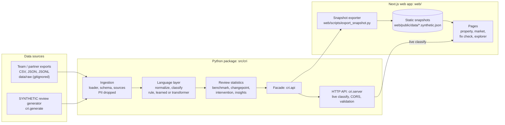
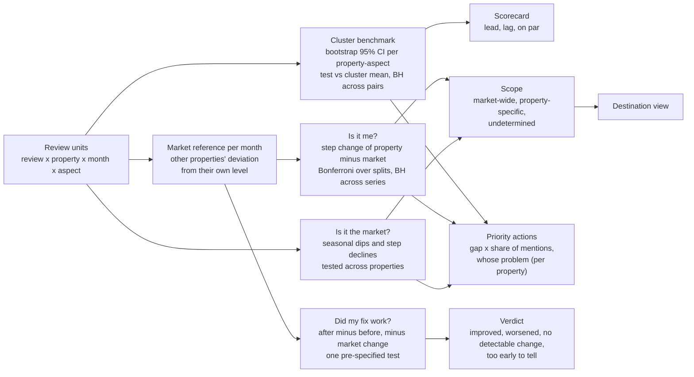

# Cluster Review Intelligence

Review intelligence for hotel and homestay owners. When a property's reviews get
worse on some aspect, is that **this property's problem** or **the whole market's**?
A single hotel cannot answer that from its own reviews. Its cluster of nearby
competitors can. The system tells an owner **where** they lag their local cluster,
**since when**, and **whose problem it is**, from reviews written in English,
romanised Hindi (Hinglish) or Devanagari.

[](https://github.com/PxA-Labs/cluster-review-intelligence/actions/workflows/ci.yml)
[](LICENSE)
[](https://securityscorecards.dev/viewer/?uri=github.com/PxA-Labs/cluster-review-intelligence)

---


**Twenty seconds, on SYNTHETIC data.** Property F's Food sentiment falls in
`2025-06`. The plain before-and-after is −1.21; the market moved +0.01 over the same
months; so −1.22 is this property's alone. Then the three kinds of verdict a decline
can get — *yours alone*, *everyone's*, *your neighbourhood's* — and one Hinglish
review splitting into `Food +1` and `Room −1`. Every figure is read from the bundled
snapshot; none is computed for the clip.

Full quality, with a scrubber:
[demo_SYNTHETIC.mp4](docs/screenshots/demo_SYNTHETIC.mp4) ·
[poster frame](docs/screenshots/demo_poster_SYNTHETIC.jpg).

> **Context.** AI–Tourism Hackathon 2026, problem statement **G5: Cluster Review
> Intelligence and Competitive Benchmarking**, by team **The Imposters**. The
> Scorecard badge populates after the first run on the public repository.
>
> **Data notice.** The bundled review data is **SYNTHETIC** (see
> [`docs/DATA_SOURCES.md`](docs/DATA_SOURCES.md)). Unknown values are written as
> `TBD` and tracked in [`docs/TODO_RESULTS.md`](docs/TODO_RESULTS.md). Accuracy on
> real reviews is `TBD` until a labelled set exists.
>
> **Scope.** On 2026-10-13 the product was cut to one user, the property owner. The
> earlier travel-intelligence layer (demand calendar, trip planner, sellers, region
> view) is preserved at the git tag `travel-layer-v1`.

---

## How it is built

All analytics live in one Python package (`cri`), reached through the facade
`cri.api`. The web app reads them from committed snapshots; only the explorer's live
review classification calls the HTTP API (`cri.server`).



## How it decides

Every verdict is a comparison against the cluster, not against the property's own
past alone. That is what separates "your kitchen slipped" from "the whole town had a
cold December".



Full rules, thresholds and their justification:
[`docs/methodology.md`](docs/methodology.md).

## Quick start

```bash
pip install -e ".[dev]"      # Python 3.11+
make sample                  # generate the SYNTHETIC review sample
make test                    # pytest
make lint                    # ruff
```

Run the web app and the API together:

```bash
uvicorn cri.server:app --port 8000
cd web && npm install && npm run dev
```

Step-by-step walkthrough, including the demo script:
[`docs/DEMO.md`](docs/DEMO.md).

## Documentation

The long-form reference that used to live in this file is now
[`docs/OVERVIEW.md`](docs/OVERVIEW.md) — the problem, the audience, the full
capability table, every architecture and pipeline diagram, the decision rules,
evaluation, limitations, configuration, project structure and deployment.

| Document | What is in it |
|---|---|
| [`docs/OVERVIEW.md`](docs/OVERVIEW.md) | Full project reference: problem, capabilities, architecture, pipeline, decision logic, evaluation, limitations, deployment |
| [`docs/methodology.md`](docs/methodology.md) | Every statistical rule, threshold and its justification |
| [`docs/SYSTEM_DESIGN.md`](docs/SYSTEM_DESIGN.md) | Design decisions and trade-offs |
| [`docs/API_CONTRACTS.md`](docs/API_CONTRACTS.md) | HTTP API endpoints, limits and real examples |
| [`docs/AI_MODEL.md`](docs/AI_MODEL.md) | Classifier backends and the model card |
| [`docs/DATA_SOURCES.md`](docs/DATA_SOURCES.md) | Where data comes from, and why the bundled set is SYNTHETIC |
| [`docs/TODO_RESULTS.md`](docs/TODO_RESULTS.md) | Every unknown value, written as `TBD` — no placeholder numbers |
| [`docs/DEMO.md`](docs/DEMO.md) | Demo walkthrough |
| [`docs/DEPLOYMENT.md`](docs/DEPLOYMENT.md) | Deploying the static site and the API |
| [`docs/PRD.md`](docs/PRD.md) · [`docs/SRS.md`](docs/SRS.md) | Product and software requirements |
| [`docs/BUSINESS_MODEL.md`](docs/BUSINESS_MODEL.md) | Who pays, and for what |
| [`docs/IMPLEMENTATION_PLAN.md`](docs/IMPLEMENTATION_PLAN.md) · [`docs/HACKATHON_PLAN.md`](docs/HACKATHON_PLAN.md) | Build plan and hackathon scope |
| [`docs/hardening.md`](docs/hardening.md) | Security hardening notes |
| [`docs/CREDITS.md`](docs/CREDITS.md) | Every asset, with source and licence |
| [`docs/screenshots/`](docs/screenshots/) | Web app screenshots and the overview clip, all on SYNTHETIC data |

## Contributing, conduct and security

[`CONTRIBUTING.md`](CONTRIBUTING.md) ·
[`CODE_OF_CONDUCT.md`](CODE_OF_CONDUCT.md) ·
[`SECURITY.md`](SECURITY.md)

## Licence

Apache License 2.0 — [`LICENSE`](LICENSE), [`NOTICE`](NOTICE). Asset and data
credits: [`docs/CREDITS.md`](docs/CREDITS.md). Built by
[Anubhav Kiroula](https://github.com/AnubhavKiroula) and team **The Imposters**.
