# Cluster Review Intelligence

Review intelligence for hotel and homestay owners. When a property's reviews get
worse on some aspect, is that **this property's problem** or **the whole market's**?
A single hotel cannot answer that from its own reviews. Its cluster of nearby
competitors can. The system tells an owner **where** they lag their local cluster,
**since when**, and **whose problem it is**, from reviews written in English,
romanised Hindi (Hinglish) or Devanagari.

MakeMyTrip, Goibibo and Booking.com are demand side: they help a traveller find a
hotel. This is supply side: it serves the properties listed on those platforms and
does not compete with them. The same analysis also gives a tourism board a
destination view.

[](https://github.com/PxA-Labs/cluster-review-intelligence/actions/workflows/ci.yml)
[](LICENSE)
[](https://securityscorecards.dev/viewer/?uri=github.com/PxA-Labs/cluster-review-intelligence)

> **Context.** AI–Tourism Hackathon 2026, problem statement **G5: Cluster Review
> Intelligence and Competitive Benchmarking**, by team **The Imposters**. The
> Scorecard badge populates after the first run on the public repository.
>
> **Data notice.** The bundled review data is **SYNTHETIC** (see
> [`docs/DATA_SOURCES.md`](docs/DATA_SOURCES.md)). Unknown values are written as
> `TBD` and tracked in [`docs/TODO_RESULTS.md`](docs/TODO_RESULTS.md).
>
> **Scope.** On 2026-10-13 the product was cut to one user, the property owner. The
> earlier travel-intelligence layer (demand calendar, trip planner, sellers, region
> view) is preserved at the git tag `travel-layer-v1`.

---

## Contents

1. [The problem](#1-the-problem)
2. [Who it is for and what it answers](#2-who-it-is-for-and-what-it-answers)
3. [Capabilities](#3-capabilities)
4. [Architecture](#4-architecture)
5. [Review analytics pipeline](#5-review-analytics-pipeline)
6. [Decision logic](#6-decision-logic)
7. [User journey](#7-user-journey)
8. [Getting started](#8-getting-started)
9. [Interfaces](#9-interfaces)
10. [Evaluation](#10-evaluation)
11. [Limitations](#11-limitations)
12. [Responsible data use](#12-responsible-data-use)
13. [Configuration](#13-configuration)
14. [Project structure](#14-project-structure)
15. [Deployment](#15-deployment)
16. [Roadmap](#16-roadmap)
17. [Documentation](#17-documentation)
18. [Contributing, conduct and security](#18-contributing-conduct-and-security)
19. [License and credits](#19-license-and-credits)

---

## 1. The problem

A single average rating hides most of what a property manager needs to act on.

- A property can hold a 4.1 average while its **food** sentiment is quietly
  collapsing, masked by strong **location** and **staff** scores.
- A dip in **room** sentiment every winter may not be a failing of that property at
  all. If every property in the cluster receives cold-room complaints each December,
  it is a **destination-level** issue, not a competitive gap.

Owners need to know which aspect they are behind on, since when, and whether the
cause is theirs. That last answer needs the cluster: one hotel's reviews cannot show
whether its competitors had the same month.

## 2. Who it is for and what it answers

**One user: the hotel or homestay owner** (or the manager who runs the property).
**One question, asked before a fix and after it:** is this decline mine or the
market's?

| Question | Output |
|---|---|
| What should I fix first, and **whose problem is it?** | Ranked priority actions (gap to the cluster × share of mentions), each tested per property: `yours alone`, `everyone's` or `not tested` |
| Where do I lead or lag my cluster? | Per-aspect scorecard with review-level 95% confidence intervals and multiple-testing-controlled lead/lag flags |
| Did something change, and since when? | Changepoints in sentiment **relative to the market**, with the month the shift began |
| Which declines are market-wide? | Each negative shift labelled `market-wide`, `property-specific` or `undetermined` |
| Did my fix work? | Before/after change **minus the market's change**, with placebo rank and minimum detectable effect |
| What exactly did guests say? | Every label traced to the clause it came from; try your own review |

Aspect taxonomy: **Food, Room, Housekeeping, Staff, Location, Value for Money,
Cleanliness, Booking Experience** (configurable in `src/cri/resources/aspects.yaml`).

## 3. Capabilities

| Area | Capability | Status | Location |
|---|---|---|---|
| Ingestion | Schema validation and CSV/JSON loader; reviewer identity dropped at ingestion | Implemented | `src/cri/loader.py`, `src/cri/schema.py` |
| Ingestion | Partner exports with other column names (aliases or a YAML mapping) | Implemented | `src/cri/sources.py` |
| Data | Seeded SYNTHETIC review generator (12 properties, injected patterns) | Implemented | `src/cri/generate.py` |
| Language | Normalisation for English, Hinglish and Devanagari, emoji and negation | Implemented | `src/cri/normalize.py` |
| Classification | Transparent rule and lexicon aspect + sentiment classifier (default) | Implemented | `src/cri/classify.py` |
| Classification | Learned sentiment backend trained on open Hinglish data, measured on held-out data | Implemented, opt-in | `src/cri/learned_backend.py`, `scripts/train_sentiment.py` |
| Classification | Multilingual transformer sentiment backend | Implemented, opt-in | `src/cri/transformer_backend.py` |
| Benchmark | Cluster benchmark with review-level bootstrap 95% CIs; FDR-controlled lead/lag flags | Implemented | `src/cri/benchmark.py` |
| Trends | "Is it me?": significance-tested changepoints relative to the market | Implemented | `src/cri/benchmark.py`, `src/cri/changepoint.py` |
| Trends | "Is it the market?": seasonal dips and step declines tested across properties | Implemented | `src/cri/benchmark.py` |
| Insight | Priority actions ("fix this first"), each with whose problem it is, and the destination view | Implemented | `src/cri/insights.py` |
| Insight | "Did my fix work?": market-adjusted before/after with timing check and placebo rank | Implemented | `src/cri/intervention.py` |
| Interface | Stable review-intelligence facade | Implemented | `src/cri/api.py` |
| Interface | HTTP API (FastAPI): live classification for the explorer, validated input, CORS | Implemented | `src/cri/server.py` |
| Interface | Next.js web app, the only user interface | Implemented | `web/` |
| Quality | Reproducible calibration of every detector on SYNTHETIC data | Implemented | `python -m cri.calibration`, `scripts/calibrate_intervention.py` |
| Quality | Evaluation harness: aspect P/R/F1, sentiment macro-F1, confusion matrix, error analysis | Implemented | `eval/predict.py`, `eval/score.py` |
| Quality | Tests: pattern recovery, null-data silence, API contract, HTTP API, learned-model parity, demo claims; CI also type-checks and builds the web app | Implemented | `tests/`, `.github/workflows/ci.yml` |
| Quality | Clause-level accuracy on real hand-labelled reviews | `TBD` (needs labelled data) | `docs/TODO_RESULTS.md` |

## 4. Architecture

### 4.1 System overview

All analytics live in one Python package (`cri`), reached through the facade
`cri.api`. The web app reads them from committed snapshots; only the explorer's live
review classification calls the HTTP API (`cri.server`). Full design and trade-offs:
[`docs/SYSTEM_DESIGN.md`](docs/SYSTEM_DESIGN.md).

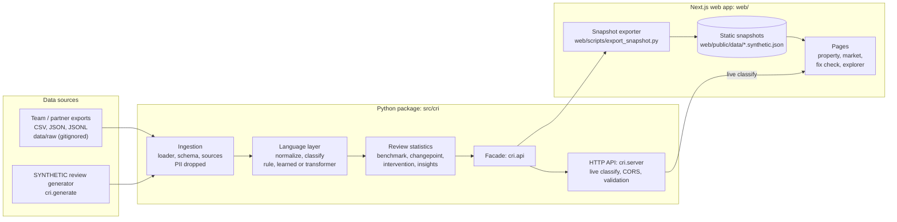

### 4.2 Module dependencies

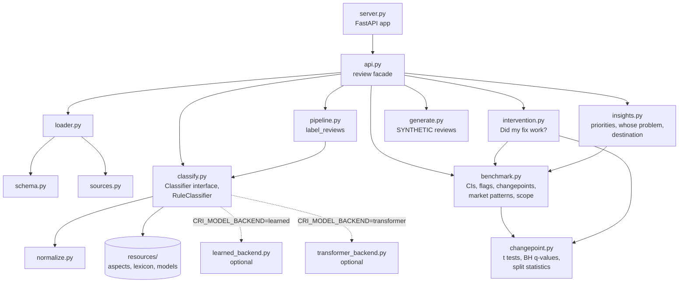

### 4.3 Request paths in the web app

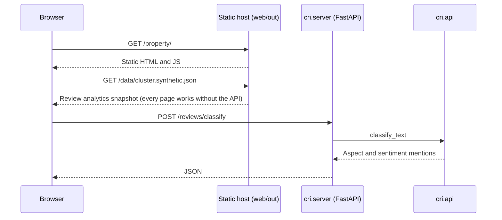

## 5. Review analytics pipeline

### 5.1 From review text to labelled mentions

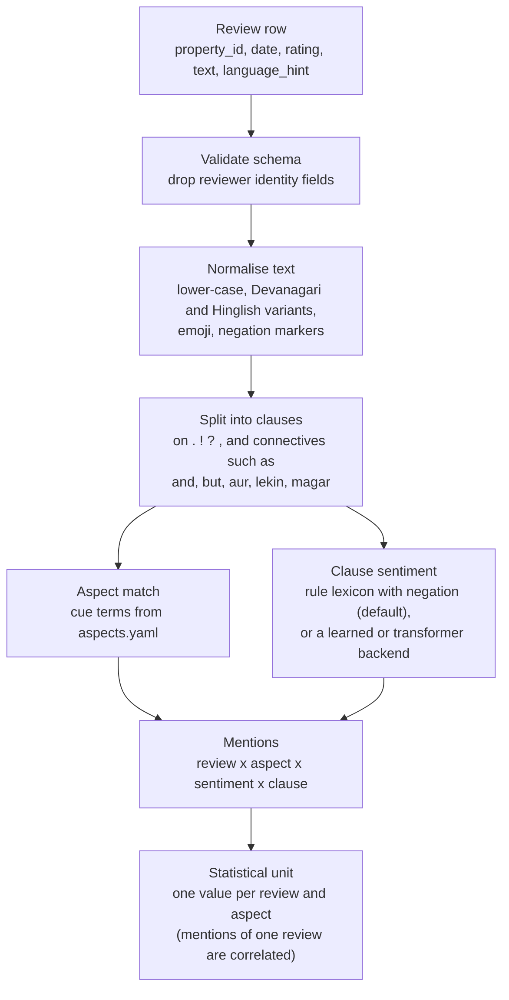

### 5.2 From labelled mentions to decisions

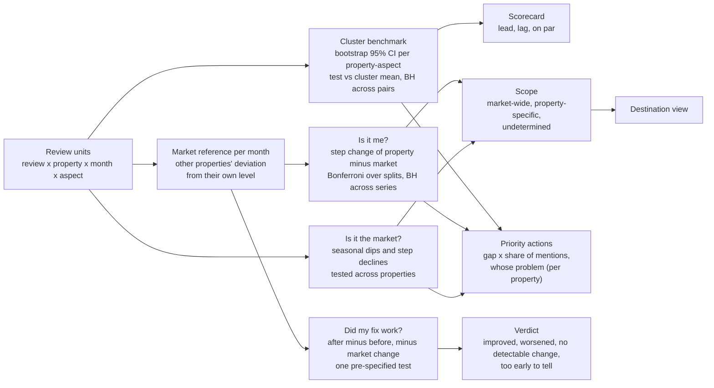

Full rules, thresholds and their justification are in
[`docs/methodology.md`](docs/methodology.md).

## 6. Decision logic

### 6.1 Lead, lag or on par

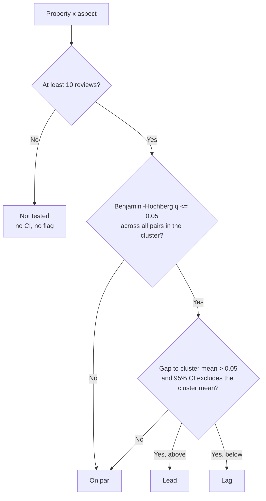

### 6.2 Is it me, or the market?


That chart labels each **aspect** for the cluster. Each **priority** on the property
page gets its own verdict, tested for that property (`priority_actions.whose_problem`).
A market-wide label is never copied onto a property's row:

- **yours alone**: the property declined relative to the market, or lags the market
  with no market-wide pattern on the aspect, or still lags once the market-wide
  patterns it takes part in are set aside;
- **everyone's**: the lag disappears once those patterns are set aside;
- **not tested**: fewer than 3 properties review the aspect, or too few reviews remain
  outside the pattern.

Example (SYNTHETIC): Room has a market-wide December dip at 12/12 properties, but
Property D is still 0.36 below the market outside December, so its Room priority is
**yours alone**.

### 6.3 Did my fix work?

The manager names the aspect and the first month after the change. The comparison
is made relative to the market, so a change every property experienced (season,
roads, a festival) cancels out. This is a difference-in-differences with the rest of
the cluster as the comparison group.

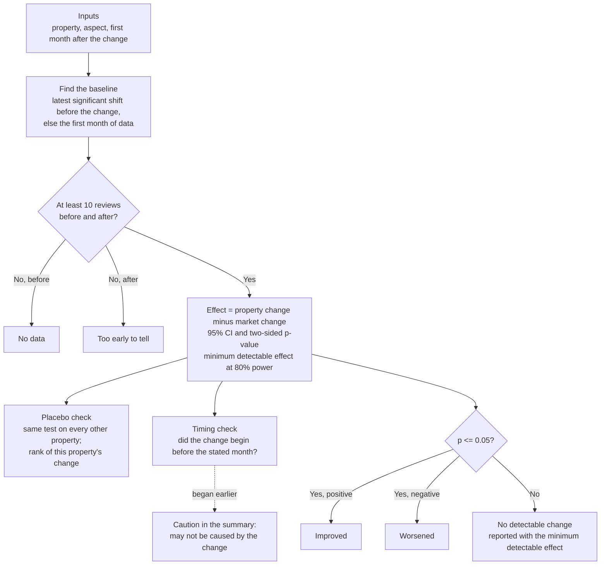

## 7. User journey

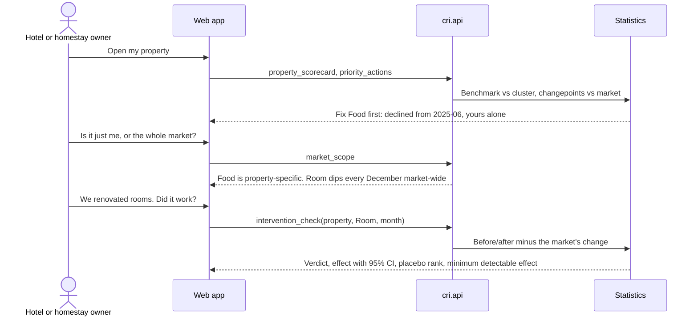

## 8. Getting started

Prerequisites: Python 3.11 or 3.12 (the pinned numpy has no 3.13 wheels) and
Node.js 22. No database and no secrets are needed.

```bash
git clone https://github.com/PxA-Labs/cluster-review-intelligence.git
cd cluster-review-intelligence
python -m pip install -e ".[dev,api]"

python -m pytest                          # tests: patterns, API, demo claims
cd web && npm ci && npm run dev           # the web app at http://localhost:3000
uvicorn cri.server:app --port 8000        # optional: live classify in the explorer
python scripts/demo.py                    # every number the demo quotes
python scripts/make_figures.py            # regenerate the figures (docs/img/)
python -m cri.calibration --seeds 1-20    # recall and false-alarm rates (about a minute)
```

Every page reads a committed snapshot (`web/public/data/*.synthetic.json`) and works
without the API; only *Try your own review* in the explorer needs it. The web app
finds the API at `NEXT_PUBLIC_API_BASE_URL` (default `http://localhost:8000`, read at
build time; see `web/.env.example`), and the API accepts browser calls from
`CRI_API_CORS_ORIGINS` (default `http://localhost:3000`; see `.env.example`).

`scripts/demo.py` prints, from the SYNTHETIC sample, every fact the 3-minute demo
([`docs/DEMO.md`](docs/DEMO.md)) relies on, including `Property F` food declining from
`2025-06` (yours alone) and cluster-wide December room complaints (market-wide).
On Windows without `make`, run the commands directly; the `Makefile` only wraps them.

## 9. Interfaces

### 9.1 Web app (`web/`)

| Page | Route | Data source |
|---|---|---|
| Home | `/` | Snapshot |
| Property: what to fix first, and whose problem it is | `/property/` | Snapshot |
| Market: market-wide vs property-specific | `/market/` | Snapshot |
| Did my fix work? | `/fix-check/` | Snapshot (precomputed results) |
| Explorer (with *Try your own review*) | `/explorer/` | Snapshot; live classification via the API |

Deep link: `/property/?property=Property%20F`.

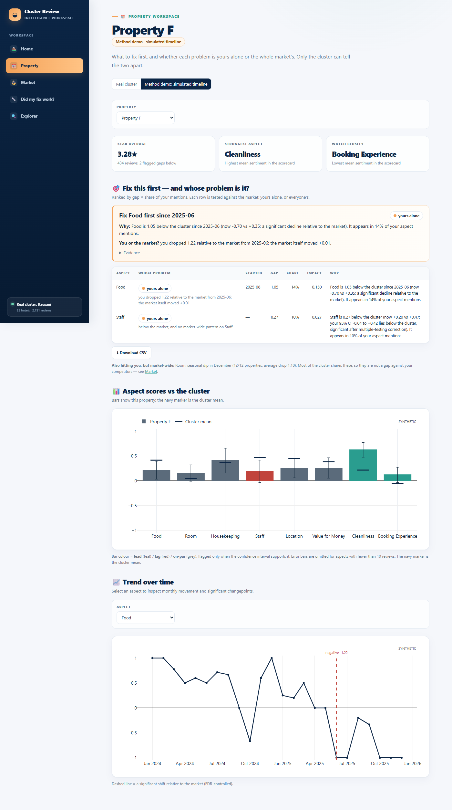

More pages, all on SYNTHETIC data:
[market quadrant](docs/screenshots/market_quadrant_SYNTHETIC.png),
[did my fix work?](docs/screenshots/fix_check_SYNTHETIC.png),
[review explorer](docs/screenshots/review_explorer_SYNTHETIC.png).

### 9.2 HTTP API (`cri.server`)

Interactive documentation is served at `/docs`. Limits and real examples:
[`docs/API_CONTRACTS.md`](docs/API_CONTRACTS.md).

| Endpoint | Returns |
|---|---|
| `GET /health` | Status and classifier backend |
| `POST /reviews/classify` | Classifier backend name and aspect-sentiment mentions with their clauses |

### 9.3 Python facade (`cri.api`)

| Function | Returns |
|---|---|
| `load_cluster(path=None, *, synthetic=True, seed=42)` | `ClusterData` (validated reviews, labelled mentions, synthetic flag) |
| `property_scorecard(d, property_id)` | Aspect, mean, 95% CI, cluster mean, gap, flag, q-value |
| `trend(d, property_id, aspect)` | Monthly mean and count |
| `changepoints(d, property_id=None, aspect=None)` | Change month, shift vs market, raw shift, p and q values |
| `market_scope(d)` | Scope per aspect with the pattern that explains it |
| `priority_actions(d, property_id, top_n=5)` | Ranked aspects with gap, volume, impact, rationale, and `whose_problem` / `whose_detail` |
| `destination_summary(d)` | Cluster-wide aspect levels, negative share, scope |
| `intervention_check(d, property_id, aspect, start, baseline_start=None)` | Verdict, effect with CI, naive and market deltas, placebo rank, minimum detectable effect |
| `search_reviews(d, ...)`, `classify_text(text)` | Explorer search; classification of one typed review |

## 10. Evaluation

No real-world clause-level accuracy figures exist yet, so none are claimed. What is
measured: whether the detectors find patterns injected into **SYNTHETIC** data and
stay quiet on pattern-free data, and how the learned sentiment model performs on
held-out public test sets.

### 10.1 Detector calibration (SYNTHETIC, 20 seeds)

Reproduce with `python -m cri.calibration --seeds 1-20`.

| Measure | Result (Wilson 95% CI) | Previous fixed-threshold detector |
|---|---|---|
| Property-specific food decline found | 15/20 (0.53–0.89) | 13/20 |
| Market-wide December dip found | 20/20 (0.84–1.00) | 20/20 |
| Pattern-free seeds with any false alarm | **1/20** | **20/20** |

Recall is limited by sample size, not tuned upward: thresholds control the
false-alarm rate, and several injected declines are small. Fresh-seed calibration
and limitations are in [`docs/methodology.md`](docs/methodology.md) sections 10–11.

### 10.2 "Did my fix work?" (SYNTHETIC simulations)

Reproduce with `python scripts/calibrate_intervention.py`. When the whole market
improved and the property did nothing special, a plain before/after comparison
credited the property in **100/100** simulated clusters; the market-adjusted check
did so in **7/100**. Real fixes of +1.0 were found in 50/50. Small fixes (+0.2) were
found in only 14/50: at this volume the check is underpowered for small changes, and
it reports the minimum detectable effect. Details:
[`docs/methodology.md`](docs/methodology.md) section 12.

### 10.3 Learned sentiment model

Held-out test sets, macro-F1 with a 95% bootstrap interval; reproduce with
`python scripts/train_sentiment.py --model open|region`.

| Test set | `open` model (shipped) | `region` model (local only) | Rule baseline |
|---|---|---|---|
| SentiMix Hinglish tweets (n = 2,997) | **0.663** (0.646–0.680) | 0.629 | 0.361 |
| Hill-destination hotel reviews, hotel-grouped, weak labels from stars (n = 8,388) | 0.390 | **0.687** (0.669–0.706) | 0.557 |

These are document-level results. On the SYNTHETIC clause-level patterns the learned
models recover the injected food decline less often than the rules (5/20 and 4/20
seeds vs 15/20), so **`rule` stays the default**. Details:
[`docs/AI_MODEL.md`](docs/AI_MODEL.md) and the model card
[`src/cri/resources/models/MODEL_CARD.md`](src/cri/resources/models/MODEL_CARD.md).

### 10.4 Clause-level accuracy on real reviews

| Metric (real labelled data) | Rule baseline | Model backend |
|---|---|---|
| Aspect macro F1 | `TBD` | `TBD` |
| Sentiment macro F1 | `TBD` | `TBD` |
| Per-aspect F1 | `TBD` | `TBD` |
| Confusion matrix and error analysis | `TBD` | `TBD` |

To produce real numbers, hand-label reviews with
[`docs/labelling_template.csv`](docs/labelling_template.csv) following
[`eval/labeling_guidelines.md`](eval/labeling_guidelines.md), then run:

```bash
python eval/predict.py eval/labelled/gold.csv --out eval/labelled/predictions.csv
python eval/score.py eval/labelled/gold.csv --predictions eval/labelled/predictions.csv
```

### 10.5 Figures (SYNTHETIC data)

| Aspect benchmark: a property vs its cluster | Cluster heatmap: property x aspect |
|---|---|
| 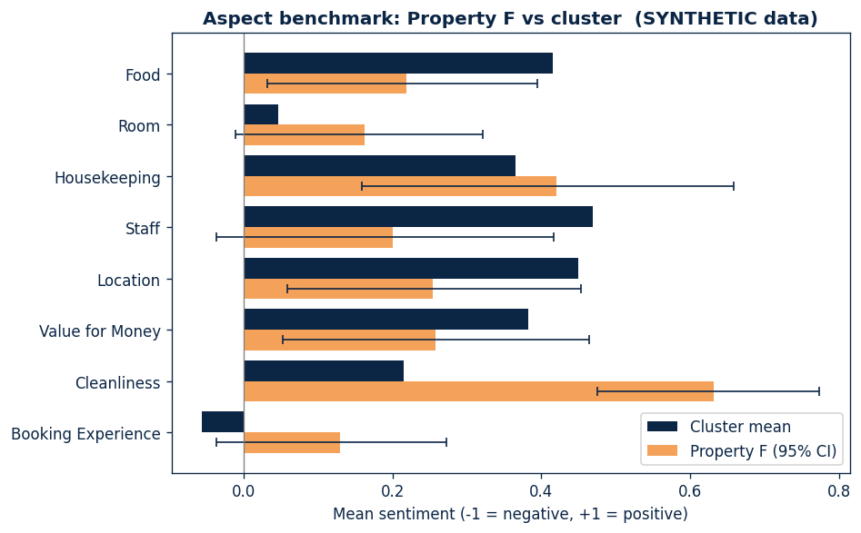 | 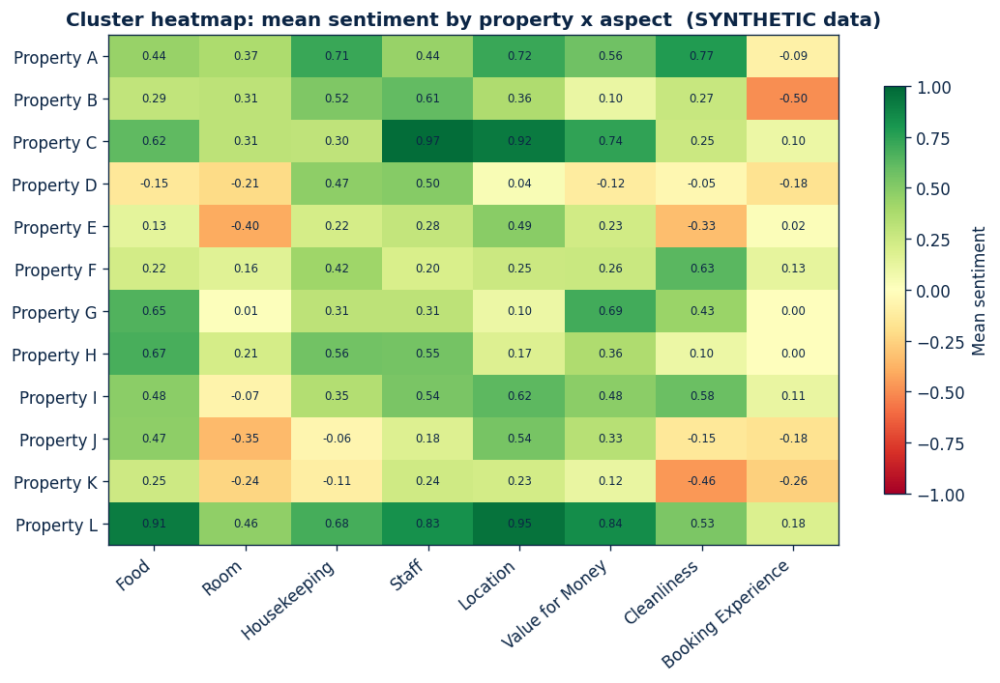 |

| Trend with changepoint | Market-wide vs property-specific |
|---|---|
| 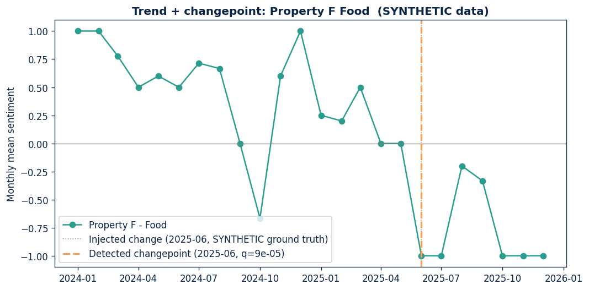 | 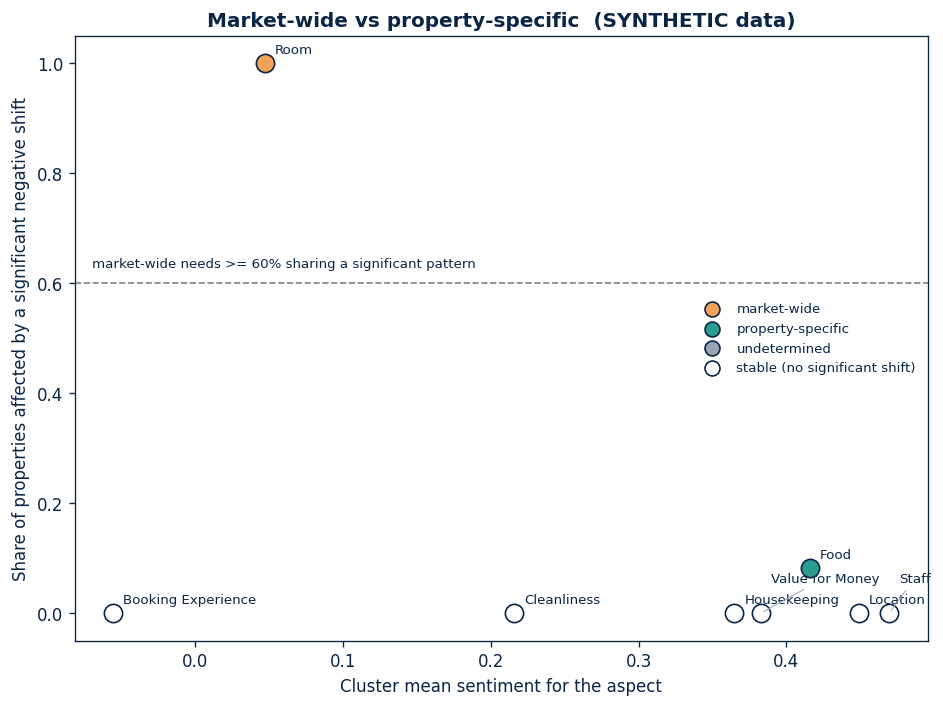 |

All four are regenerated by `scripts/make_figures.py` from `seed=42`. They depict
**SYNTHETIC** data, not real properties.

## 11. Limitations

- **Rule and lexicon baseline.** Misses sarcasm, implicit sentiment and
  out-of-lexicon slang. Hindi negation after the word ("accha nahi tha") is handled
  since 2026-10-13. The learned and transformer backends
  target these; their clause-level accuracy on real reviews is `TBD`.
- **Limited statistical power.** With about 100 reviews per property-aspect over two
  years, only large shifts are detected at a 5% false-discovery rate. Thresholds are
  not loosened to inflate recall.
- **False-discovery control, not zero false alarms.** Once a real finding exists,
  Benjamini–Hochberg admits more marginal ones (about 0.1 extra changepoints per
  synthetic seed).
- **Seasonality needs two years.** A dip is called seasonal only if it recurs in every
  observed year.
- **One changepoint per series.** The reported shift at the best split is biased
  upward. Multiple-changepoint methods (for example PELT) are not implemented.
- **Small clusters.** Market-wide patterns need several properties to agree; below 3
  properties an aspect's scope is `undetermined`, and priorities compare a property
  with its own history instead.
- **Intervention checks are not proof of cause.** Anything else that changed in the
  same month is mixed in, and a fix made right after an unusually bad month can look
  like an improvement.
- **Synthetic validation only.** Calibration shows the statistics behave as designed,
  not real-world accuracy.

## 12. Responsible data use

- **No scraping.** The pipeline reads CSV/JSON files the team provides. It does not
  access platforms, logins or rate-limited endpoints.
- **No personal data.** Reviewer identity fields are dropped at ingestion
  (`src/cri/schema.py`). Real properties are anonymised (Property A, B, ...) in
  anything public.
- **Synthetic data is labelled.** Bundled data carries `synthetic` in its filename and
  `SYNTHETIC` on every figure and page.
- **No secrets in git.** Configuration is via environment variables; see `.env.example`.
- **Platform terms.** Check each platform's terms before using any real export.
- **Third-party review data stays local.** The Kaggle hill-destination reviews used to
  train the local `region` model are downloaded by a team member, never committed,
  read without reviewer columns, and the model trained on them is not distributed.
  The shipped model uses CC BY 4.0 data only
  ([`docs/DATA_SOURCES.md`](docs/DATA_SOURCES.md)).

Supply-chain hardening (pinned dependencies, action SHAs, token permissions,
Dependabot, and the manual GitHub settings still to enable) is tracked in
[`docs/hardening.md`](docs/hardening.md).

## 13. Configuration

| Variable | Where | Default | Purpose |
|---|---|---|---|
| `CRI_DATA_RAW_DIR` | API / Python | `data/raw` | Directory of team-provided exports (gitignored) |
| `CRI_API_CORS_ORIGINS` | API | `http://localhost:3000,http://127.0.0.1:3000` | Browser origins allowed to call the API (comma-separated) |
| `CRI_ASPECTS_PATH` | API / Python | bundled `aspects.yaml` | Override the aspect taxonomy |
| `CRI_MODEL_BACKEND` | API / Python | `rule` | Sentiment backend: `rule`, `learned` or `transformer` |
| `CRI_LEARNED_MODEL_PATH` | API / Python | packaged open model | Model file for the `learned` backend; locally trained models stay outside git |
| `NEXT_PUBLIC_API_BASE_URL` | Web app (build time) | `http://localhost:8000` | Where the web app finds the API; rebuild after changing it |

Copy `.env.example` to `.env` and `web/.env.example` to `web/.env.local` (both
gitignored). The project runs fully offline on the SYNTHETIC sample with none of
these set.

## 14. Project structure

```
web/                Next.js app (the only UI): four pages on a static snapshot
src/cri/api.py      review-intelligence facade (stable contract)
src/cri/server.py   FastAPI service: live classify for the explorer
src/cri/            schema, loader, sources, generate, normalize, classify, pipeline,
                    benchmark, changepoint, insights, intervention, calibration,
                    transformer_backend, learned_backend
src/cri/resources/  aspects.yaml, lexicon.yaml, models/ (shipped open model)
eval/               predict.py, score.py, labelling guide, split_labels.py
scripts/            demo, make_figures, capture_screenshots, calibrate_intervention,
                    prepare_region_reviews, train_sentiment
tests/              pattern recovery, API, server, learned model, demo claims
data/sample/        SYNTHETIC reviews (committed); data/raw/ is gitignored
docs/               PRD, SRS, SYSTEM_DESIGN, AI_MODEL, BUSINESS_MODEL, DATA_SOURCES,
                    API_CONTRACTS, IMPLEMENTATION_PLAN, DEMO, DEPLOYMENT,
                    methodology, data_schema, CREDITS, TODO_RESULTS, img/, screenshots/
.github/workflows/  ci.yml (Python + web), codeql.yml, scorecard.yml (SHA-pinned)
```

## 15. Deployment

Two pieces, neither needing secrets. The static web app can be served from any static
host (Vercel is the documented primary) and is the whole product on its own. The API
is optional: it powers only the explorer's live classification and runs on any
Python host that keeps a long-lived web process. Neither is deployed yet; URLs are `TBD`. Step-by-step
instructions: [`docs/DEPLOYMENT.md`](docs/DEPLOYMENT.md).

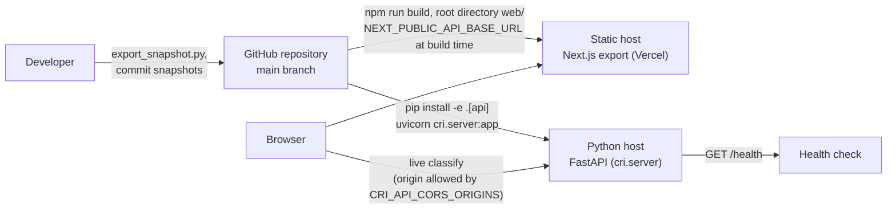

Real review data is never deployed publicly.

## 16. Roadmap

| Item | Description | Status |
|---|---|---|
| Real labelled evaluation | Hand-label real reviews; run `eval/predict.py` and `eval/score.py`; replace the `TBD`s | Planned |
| Clause-level gold set | Hill-destination reviews labelled per clause, to decide whether the learned backend should replace the rules | Planned |
| Public deployment | Static site in `web/` plus the API; URLs recorded in this README | Planned |
| Transformer evaluation | Compare with the rule baseline on the real labelled set; make it the default only if it wins | Planned |
| Multiple changepoints | PELT or similar, once real data allows the penalty to be calibrated | Planned |

## 17. Documentation

| Document | Contents |
|---|---|
| [PRD](docs/PRD.md), [SRS](docs/SRS.md) | Product requirements; requirement IDs traced to tests |
| [SYSTEM_DESIGN](docs/SYSTEM_DESIGN.md), [API_CONTRACTS](docs/API_CONTRACTS.md) | Architecture and data flows; endpoints with real examples |
| [AI_MODEL](docs/AI_MODEL.md), [methodology](docs/methodology.md) | Classifiers and the learned model; review statistics |
| [DATA_SOURCES](docs/DATA_SOURCES.md) | Real vs SYNTHETIC vs assumption, licences, gaps |
| [BUSINESS_MODEL](docs/BUSINESS_MODEL.md) | One payer (the property owner), positioning, revenue hypotheses |
| [IMPLEMENTATION_PLAN](docs/IMPLEMENTATION_PLAN.md), [TODO_RESULTS](docs/TODO_RESULTS.md) | Status, limitations, next steps; every `TBD` |
| [DEMO](docs/DEMO.md), [DEPLOYMENT](docs/DEPLOYMENT.md) | The 3-minute demo, every number test-pinned; hosting |

## 18. Contributing, conduct and security

- Contribution workflow, standards and the definition of done:
  [`CONTRIBUTING.md`](CONTRIBUTING.md)
- Community standards: [`CODE_OF_CONDUCT.md`](CODE_OF_CONDUCT.md) (Contributor
  Covenant 2.1)
- Reporting vulnerabilities privately: [`SECURITY.md`](SECURITY.md)

**Team: The Imposters**

| Member | Role |
|---|---|
| Archit Mittal | Team lead; data, evaluation and ops |
| Purvansh Joshi | Web app |
| Anubhav Kiroula | Analytics core; repository maintainer ([@AnubhavKiroula](https://github.com/AnubhavKiroula)) |

## 19. License and credits

Licensed under the [Apache License, Version 2.0](LICENSE); see also [`NOTICE`](NOTICE).
The banner and charts are original or generated by this project; no scraped photos
are used. Asset credits are recorded in [`docs/CREDITS.md`](docs/CREDITS.md).
