# Cluster Review Intelligence

Aspect-level, competitive and time-aware analytics for tourist reviews, extended into
a travel-intelligence layer for Uttarakhand and Himachal hill destinations. The
system tells a property manager **where** they lag their local cluster, **since
when**, and whether a problem is **their own or the whole market's**. It then puts
that evidence to work for travellers, accommodation providers, local sellers and
tourism boards. Reviews may be written in English, romanised Hindi (Hinglish) or
Devanagari.

[](https://github.com/PxA-Labs/cluster-review-intelligence/actions/workflows/ci.yml)
[](LICENSE)
[](https://securityscorecards.dev/viewer/?uri=github.com/PxA-Labs/cluster-review-intelligence)

> **Context.** AI–Tourism Hackathon 2026, problem statement **G5: Cluster Review
> Intelligence and Competitive Benchmarking**. The Scorecard badge populates after
> the first run on the public repository.
>
> **Data notice.** Review data, stays, prices and sellers are **SYNTHETIC**.
> Holidays, distances, arrivals and emission factors are sourced facts (see
> [`docs/DATA_SOURCES.md`](docs/DATA_SOURCES.md)). Unknown values are written as
> `TBD` and tracked in [`docs/TODO_RESULTS.md`](docs/TODO_RESULTS.md).

---

## Contents

1. [The problem](#1-the-problem)
2. [Who it is for and what it answers](#2-who-it-is-for-and-what-it-answers)
3. [Capabilities](#3-capabilities)
4. [Architecture](#4-architecture)
5. [Review analytics pipeline](#5-review-analytics-pipeline)
6. [Decision logic](#6-decision-logic)
7. [Travel intelligence](#7-travel-intelligence)
8. [User journeys](#8-user-journeys)
9. [Getting started](#9-getting-started)
10. [Interfaces](#10-interfaces)
11. [Evaluation](#11-evaluation)
12. [Limitations](#12-limitations)
13. [Responsible data use](#13-responsible-data-use)
14. [Configuration](#14-configuration)
15. [Project structure](#15-project-structure)
16. [Deployment](#16-deployment)
17. [Roadmap](#17-roadmap)
18. [Documentation](#18-documentation)
19. [Contributing, conduct and security](#19-contributing-conduct-and-security)
20. [License and credits](#20-license-and-credits)

---

## 1. The problem

A single average rating hides most of what a property manager needs to act on.

- A property can hold a 4.1 average while its **food** sentiment is quietly
  collapsing, masked by strong **location** and **staff** scores.
- A dip in **room** sentiment every winter may not be a failing of that property at
  all. If every property in the cluster receives cold-room complaints each December,
  it is a **destination-level** issue, not a competitive gap.

Managers need to know which aspect they are behind on, since when, and whether the
cause is theirs. Tourism boards need to know which problems move together across a
destination, and when visitor pressure peaks. Travellers need to know when a place
will be crowded and what the quieter alternatives are.

## 2. Who it is for and what it answers

| Audience | Question | Output |
|---|---|---|
| Property manager | Where do I lead or lag my cluster? | Per-aspect scorecard with review-level 95% confidence intervals and multiple-testing-controlled lead/lag flags |
| Property manager | Did something change, and since when? | Changepoints in sentiment **relative to the market**, with the month the shift began |
| Manager, tourism board | Is it me, or the whole market? | Each negative shift labelled `market-wide`, `property-specific` or `undetermined` |
| Property manager | What should I fix first? | Ranked priority actions: gap to the cluster multiplied by share of mentions |
| Property manager | Did my fix work? | Before/after change **minus the market's change**, with placebo rank and minimum detectable effect |
| Tourism board | Which issues and pressures affect the destination? | Destination view of shared issues; expected visitor pressure against assumed capacity ceilings |
| Traveller (students, families, budget travellers) | When is it crowded, and where else could I go? | Holiday-aware crowd estimates, quieter dates, similar less-crowded places, stays compared **without star ratings** |
| Traveller | What would a trip cost? | Budget trip plan with traced costs, local sellers and a car vs bus carbon estimate |
| Accommodation provider | Where should I act? | Review priorities, demand peaks against room mix, amenity gaps, quiet windows for offers |
| Local seller (artisans, weavers, guides) | How do travellers find me? | Discovery inside trip plans; tourism boards see under-served seller categories |

Aspect taxonomy: **Food, Room, Housekeeping, Staff, Location, Value for Money,
Cleanliness, Booking Experience** (configurable in `src/cri/resources/aspects.yaml`).

## 3. Capabilities

| Area | Capability | Status | Location |
|---|---|---|---|
| Ingestion | Schema validation and CSV/JSON loader; reviewer identity dropped at ingestion | Implemented | `src/cri/loader.py`, `src/cri/schema.py` |
| Ingestion | Partner exports with other column names (aliases or a YAML mapping) | Implemented | `src/cri/sources.py` |
| Data | Seeded SYNTHETIC review generator (12 properties, injected patterns) | Implemented | `src/cri/generate.py` |
| Language | Normalisation for English, Hinglish and Devanagari, emoji and negation | Implemented | `src/cri/normalize.py` |
| Classification | Transparent rule and lexicon aspect + sentiment classifier (default) | Implemented | `src/cri/classify.py` |
| Classification | Learned sentiment backend trained on open Hinglish data, measured on held-out data | Implemented, opt-in | `src/cri/learned_backend.py`, `scripts/train_sentiment.py` |
| Classification | Multilingual transformer sentiment backend | Implemented, opt-in | `src/cri/transformer_backend.py` |
| Benchmark | Cluster benchmark with review-level bootstrap 95% CIs; FDR-controlled lead/lag flags | Implemented | `src/cri/benchmark.py` |
| Trends | "Is it me?": significance-tested changepoints relative to the market | Implemented | `src/cri/benchmark.py`, `src/cri/changepoint.py` |
| Trends | "Is it the market?": seasonal dips and step declines tested across properties | Implemented | `src/cri/benchmark.py` |
| Insight | Priority actions ("fix this first") and the tourism-board destination view | Implemented | `src/cri/insights.py` |
| Insight | "Did my fix work?": market-adjusted before/after with timing check and placebo rank | Implemented | `src/cri/intervention.py` |
| Travel | Holiday-aware demand index (0–100, every point explained): an estimate, not live traffic | Implemented | `src/cri/travel/demand.py` |
| Travel | Crowd-aware alternatives with a capacity guard and five-part explanations | Implemented | `src/cri/travel/alternatives.py` |
| Travel | Star-free stay profiles and provider insights | Implemented | `src/cri/travel/stays.py` |
| Travel | Local sellers, seller-category opportunity (not sales) and the regional pressure view | Implemented | `src/cri/travel/region.py` |
| Travel | Trip planner with traced costs, carbon estimate, cheaper and quieter variants | Implemented | `src/cri/travel/planner.py` |
| Interface | Stable review-intelligence facade | Implemented | `src/cri/api.py` |
| Interface | HTTP API (FastAPI) for the web app: review core and travel layer, validated inputs, CORS | Implemented | `src/cri/server.py` |
| Interface | Next.js web app, the only user interface | Implemented | `web/` |
| Quality | Reproducible calibration of every detector on SYNTHETIC data | Implemented | `python -m cri.calibration`, `scripts/calibrate_intervention.py` |
| Quality | Evaluation harness: aspect P/R/F1, sentiment macro-F1, confusion matrix, error analysis | Implemented | `eval/predict.py`, `eval/score.py` |
| Quality | Tests: pattern recovery, null-data silence, API contract, HTTP API, travel invariants, learned-model parity, demo claims; CI also type-checks and builds the web app | Implemented | `tests/`, `.github/workflows/ci.yml` |
| Quality | Clause-level accuracy on real hand-labelled reviews | `TBD` (needs labelled data) | `docs/TODO_RESULTS.md` |

## 4. Architecture

### 4.1 System overview

All analytics live in one Python package (`cri`). The review core is reached through
the facade `cri.api`; the travel layer lives in `cri.travel`; both are served over
HTTP by `cri.server`. The web app reads review analytics from committed snapshots
and calls the API for the travel pages and live review classification. Full design
and trade-offs: [`docs/SYSTEM_DESIGN.md`](docs/SYSTEM_DESIGN.md).

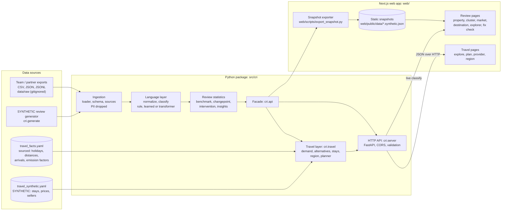

### 4.2 Module dependencies

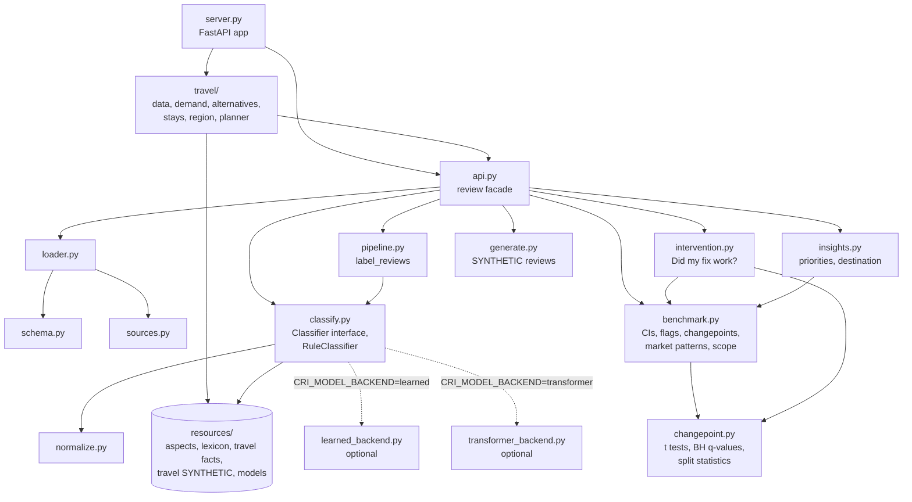

### 4.3 Request paths in the web app

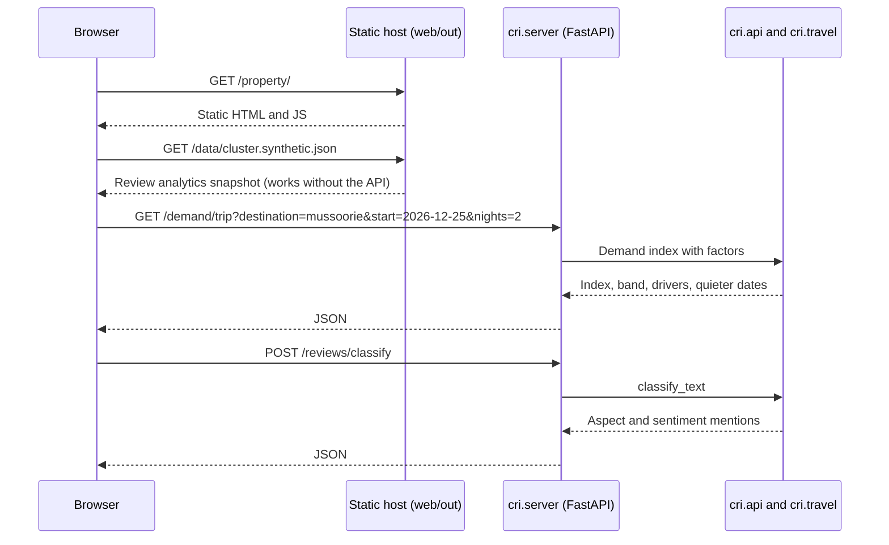

## 5. Review analytics pipeline

### 5.1 From review text to labelled mentions

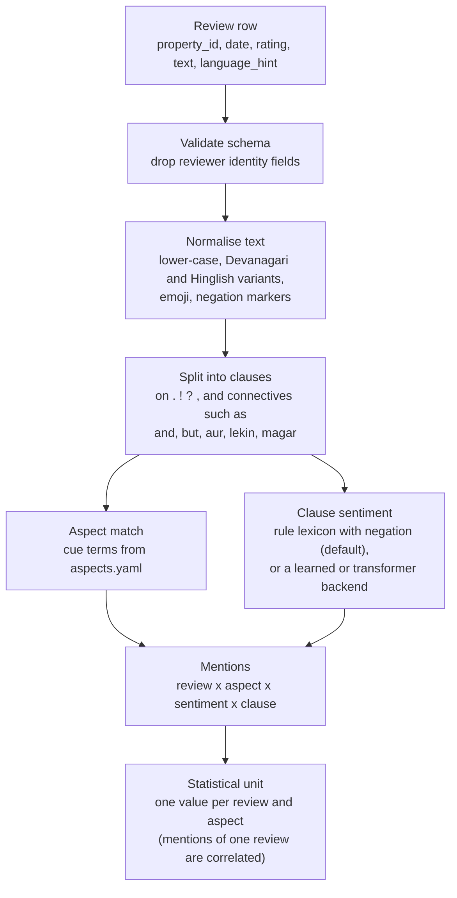

### 5.2 From labelled mentions to decisions

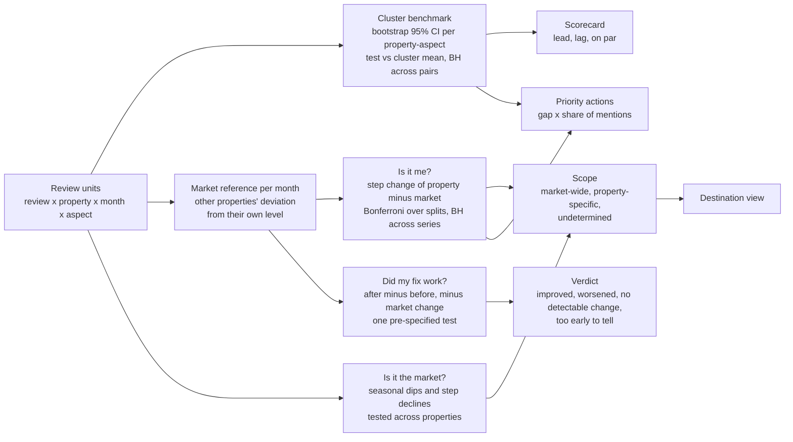

Full rules, thresholds and their justification are in
[`docs/methodology.md`](docs/methodology.md).

## 6. Decision logic

### 6.1 Lead, lag or on par

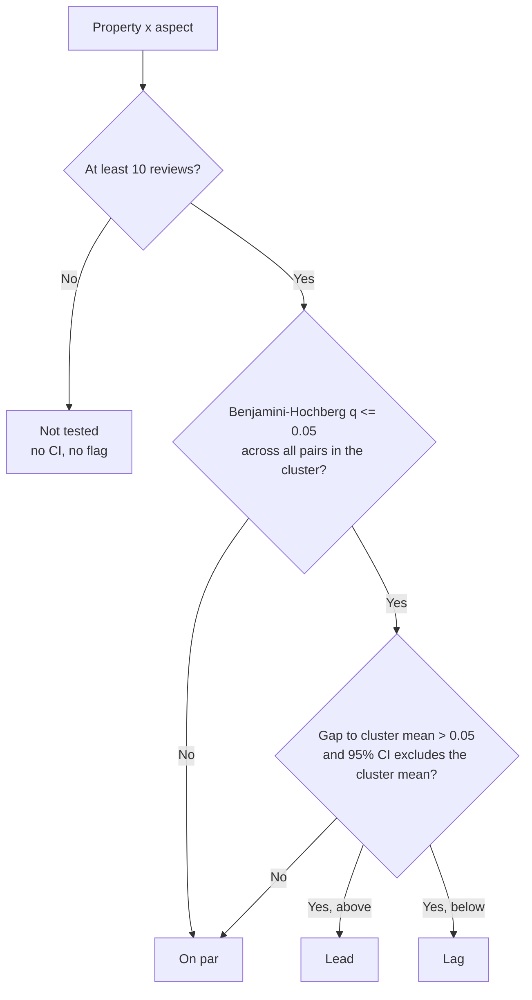

### 6.2 Is it me, or the market?

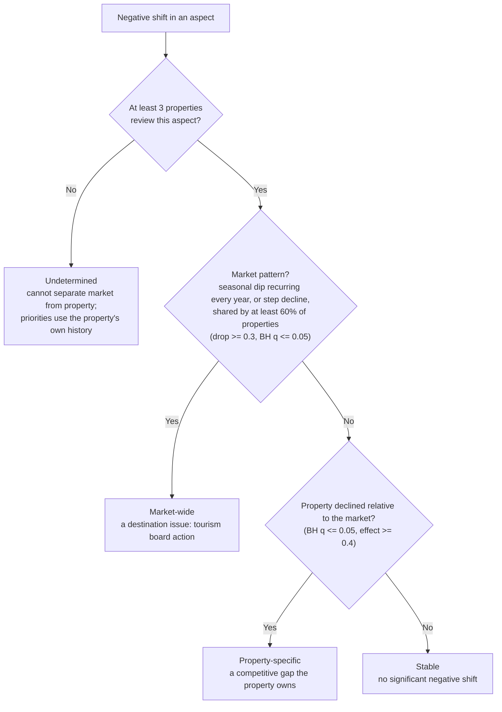

### 6.3 Did my fix work?

The manager names the aspect and the first month after the change. The comparison
is made relative to the market, so a change every property experienced (season,
roads, a festival) cancels out. This is a difference-in-differences with the rest of
the cluster as the comparison group.

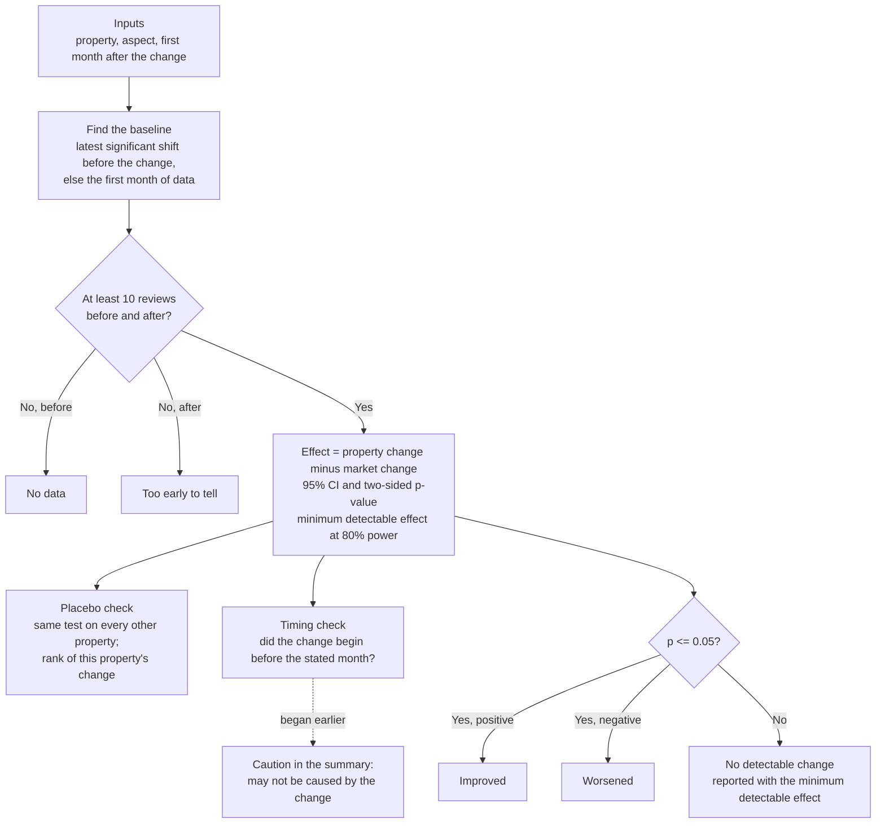

## 7. Travel intelligence

The travel engines are transparent by design, because there is no footfall or
booking data to train on. Every number they return carries its **basis**: `fact`
(cited source), `measured`, `derived`, `synthetic` or `assumption`. Formulas,
evaluation and limits: [`docs/AI_MODEL.md`](docs/AI_MODEL.md).

### 7.1 Demand index

The index always equals the sum of the factors shown, clipped to 0–100. Holidays come
from the DoPT lists for 2026–27; state holidays and live traffic are not modelled.

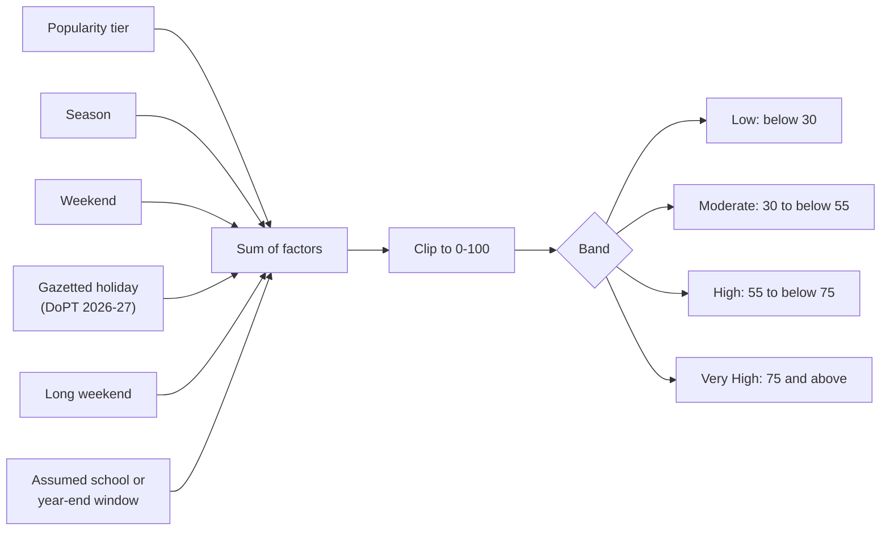

### 7.2 Alternatives, stays, providers, sellers and trip plans

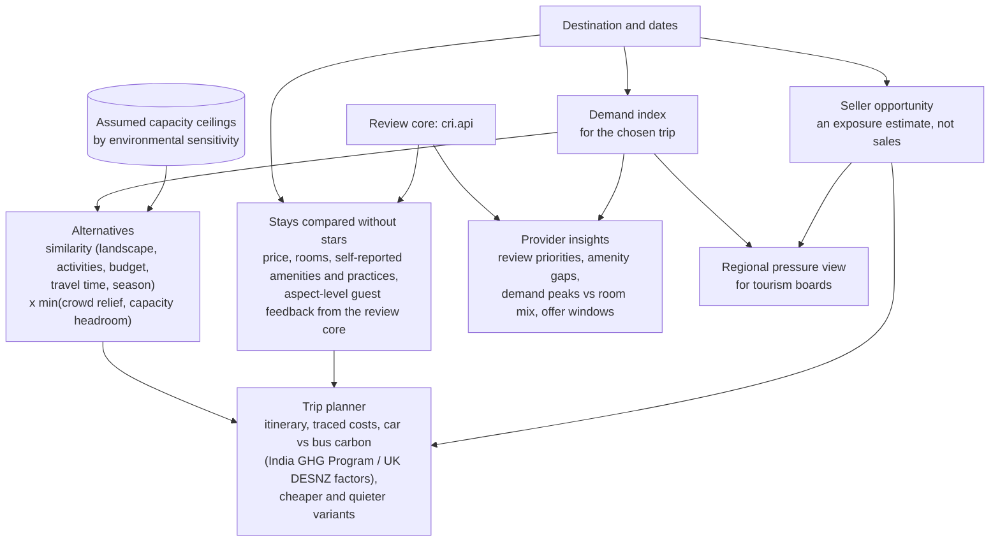

## 8. User journeys

### 8.1 Property manager

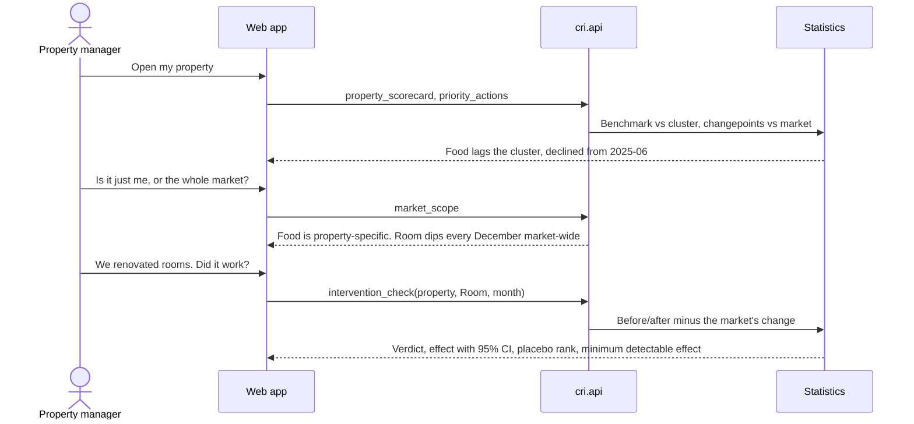

### 8.2 Traveller

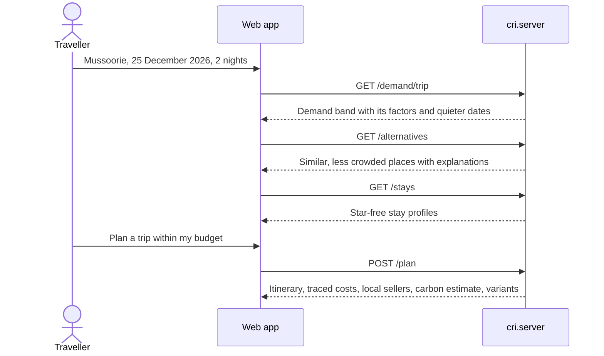

### 8.3 Tourism board

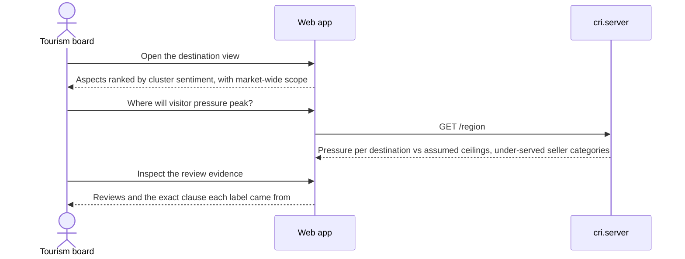

## 9. Getting started

Prerequisites: Python 3.11 or 3.12 (the pinned numpy has no 3.13 wheels) and
Node.js 22. No database and no secrets are needed.

```bash
git clone https://github.com/PxA-Labs/cluster-review-intelligence.git
cd cluster-review-intelligence
python -m pip install -e ".[dev,api]"

python -m pytest                          # tests: patterns, API, travel invariants
uvicorn cri.server:app --port 8000        # the API (terminal 1; docs at /docs)
cd web && npm ci && npm run dev           # the web app at http://localhost:3000 (terminal 2)
python scripts/demo.py                    # every number the G5 demo quotes
python scripts/make_figures.py            # regenerate the figures (docs/img/)
python -m cri.calibration --seeds 1-20    # recall and false-alarm rates (about a minute)
```

The review pages read a committed snapshot (`web/public/data/*.synthetic.json`) and
work without the API; the travel pages and *Try your own review* need it. The web app
finds the API at `NEXT_PUBLIC_API_BASE_URL` (default `http://localhost:8000`, read at
build time; see `web/.env.example`), and the API accepts browser calls from
`CRI_API_CORS_ORIGINS` (default `http://localhost:3000`; see `.env.example`).

`scripts/demo.py` prints, from the SYNTHETIC sample, the facts the judge demo
([`docs/DEMO.md`](docs/DEMO.md)) relies on, including `Property F` food declining from
`2025-06` (property-specific) and cluster-wide December room complaints
(market-wide). The full-product demo is [`docs/DEMO_SCRIPT.md`](docs/DEMO_SCRIPT.md).
On Windows without `make`, run the commands directly; the `Makefile` only wraps them.

## 10. Interfaces

### 10.1 Web app (`web/`)

| Page | Route | Data source |
|---|---|---|
| Home | `/` | Snapshot |
| Property | `/property/` | Snapshot |
| Cluster | `/cluster/` | Snapshot |
| Market | `/market/` | Snapshot |
| Destination | `/destination/` | Snapshot |
| Explorer (with *Try your own review*) | `/explorer/` | Snapshot; live classification via the API |
| Did my fix work? | `/fix-check/` | Snapshot (precomputed results) |
| When and where to go | `/explore/` | API |
| Plan a trip | `/plan/` | API |
| Provider insights | `/provider/` | API |
| Regional pressure | `/region/` | API |

Deep links: `/property/?property=Property%20F`,
`/explore/?destination=mussoorie&start=2026-12-25&nights=2`.


More pages, all on SYNTHETIC data:
[trip planner](docs/screenshots/plan_SYNTHETIC.png),
[provider insights](docs/screenshots/provider_SYNTHETIC.png),
[regional pressure](docs/screenshots/region_SYNTHETIC.png),
[market quadrant](docs/screenshots/market_quadrant_SYNTHETIC.png),
[review explorer](docs/screenshots/review_explorer_SYNTHETIC.png).

### 10.2 HTTP API (`cri.server`)

Interactive documentation is served at `/docs`. Parameters, limits and real examples:
[`docs/API_CONTRACTS.md`](docs/API_CONTRACTS.md).

| Endpoint | Returns |
|---|---|
| `GET /health` | Status, SYNTHETIC flag, classifier backend, demand model |
| `GET /meta` | Destinations, origins, properties, interests, seller categories, holidays with sources, assumptions and factors |
| `GET /demand/calendar` | Demand per day for a destination |
| `GET /demand/trip` | Trip demand, top drivers, quieter dates |
| `GET /demand/overview` | Per destination: mean index, peak day, days per band |
| `GET /alternatives` | Ranked alternatives with components and explanations; excluded candidates with reasons |
| `GET /stays` | Star-free stay profiles |
| `GET /provider/{property_id}/insights` | Provider profile and ranked insights |
| `GET /sellers`, `GET /sellers/opportunities` | Sellers; category exposure scores |
| `GET /region` | Pressure per destination, under-served seller categories, review issues |
| `POST /plan` | Trip plan |
| `POST /reviews/classify` | Classifier backend name and aspect-sentiment mentions |

### 10.3 Python facade (`cri.api`)

| Function | Returns |
|---|---|
| `load_cluster(path=None, *, synthetic=True, seed=42)` | `ClusterData` (validated reviews, labelled mentions, synthetic flag) |
| `property_scorecard(d, property_id)` | Aspect, mean, 95% CI, cluster mean, gap, flag, q-value |
| `trend(d, property_id, aspect)` | Monthly mean and count |
| `changepoints(d, property_id=None, aspect=None)` | Change month, shift vs market, raw shift, p and q values |
| `market_scope(d)` | Scope per aspect with the pattern that explains it |
| `priority_actions(d, property_id, top_n=5)` | Ranked aspects with gap, volume, impact and rationale |
| `destination_summary(d)` | Cluster-wide aspect levels, negative share, scope |
| `intervention_check(d, property_id, aspect, start, baseline_start=None)` | Verdict, effect with CI, naive and market deltas, placebo rank, minimum detectable effect |
| `search_reviews(d, ...)`, `classify_text(text)` | Explorer search; classification of one typed review |

## 11. Evaluation

No real-world clause-level accuracy figures exist yet, so none are claimed. What is
measured: whether the detectors find patterns injected into **SYNTHETIC** data and
stay quiet on pattern-free data, and how the learned sentiment model performs on
held-out public test sets.

### 11.1 Detector calibration (SYNTHETIC, 20 seeds)

Reproduce with `python -m cri.calibration --seeds 1-20`.

| Measure | Result (Wilson 95% CI) | Previous fixed-threshold detector |
|---|---|---|
| Property-specific food decline found | 15/20 (0.53–0.89) | 13/20 |
| Market-wide December dip found | 20/20 (0.84–1.00) | 20/20 |
| Pattern-free seeds with any false alarm | **1/20** | **20/20** |

Recall is limited by sample size, not tuned upward: thresholds control the
false-alarm rate, and several injected declines are small. Fresh-seed calibration
and limitations are in [`docs/methodology.md`](docs/methodology.md) sections 10–11.

### 11.2 "Did my fix work?" (SYNTHETIC simulations)

Reproduce with `python scripts/calibrate_intervention.py`. When the whole market
improved and the property did nothing special, a plain before/after comparison
credited the property in **100/100** simulated clusters; the market-adjusted check
did so in **7/100**. Real fixes of +1.0 were found in 50/50. Small fixes (+0.2) were
found in only 14/50: at this volume the check is underpowered for small changes, and
it reports the minimum detectable effect. Details:
[`docs/methodology.md`](docs/methodology.md) section 12.

### 11.3 Learned sentiment model

Held-out test sets, macro-F1 with a 95% bootstrap interval; reproduce with
`python scripts/train_sentiment.py --model open|region`.

| Test set | `open` model (shipped) | `region` model (local only) | Rule baseline |
|---|---|---|---|
| SentiMix Hinglish tweets (n = 2,997) | **0.663** (0.646–0.680) | 0.629 | 0.361 |
| Hill-destination hotel reviews, hotel-grouped, weak labels from stars (n = 8,388) | 0.390 | **0.687** (0.669–0.706) | 0.557 |

These are document-level results. On the SYNTHETIC clause-level patterns the learned
models recover the injected food decline less often than the rules (5/20 and 4/20
seeds vs 15/20), so **`rule` stays the default**. Details:
[`docs/AI_MODEL.md`](docs/AI_MODEL.md) and the model card
[`src/cri/resources/models/MODEL_CARD.md`](src/cri/resources/models/MODEL_CARD.md).

### 11.4 Clause-level accuracy on real reviews

| Metric (real labelled data) | Rule baseline | Model backend |
|---|---|---|
| Aspect macro F1 | `TBD` | `TBD` |
| Sentiment macro F1 | `TBD` | `TBD` |
| Per-aspect F1 | `TBD` | `TBD` |
| Confusion matrix and error analysis | `TBD` | `TBD` |

To produce real numbers, hand-label reviews with
[`docs/labelling_template.csv`](docs/labelling_template.csv) following
[`eval/labeling_guidelines.md`](eval/labeling_guidelines.md), then run:

```bash
python eval/predict.py eval/labelled/gold.csv --out eval/labelled/predictions.csv
python eval/score.py eval/labelled/gold.csv --predictions eval/labelled/predictions.csv
```

### 11.5 Figures (SYNTHETIC data)

| Aspect benchmark: a property vs its cluster | Cluster heatmap: property x aspect |
|---|---|
|  |  |

| Trend with changepoint | Market-wide vs property-specific |
|---|---|
|  |  |

All four are regenerated by `scripts/make_figures.py` from `seed=42`. They depict
**SYNTHETIC** data, not real properties.

## 12. Limitations

- **Rule and lexicon baseline.** Misses sarcasm, implicit sentiment, post-negation
  ("accha nahi tha") and out-of-lexicon slang. The learned and transformer backends
  target these; their clause-level accuracy on real reviews is `TBD`.
- **Limited statistical power.** With about 100 reviews per property-aspect over two
  years, only large shifts are detected at a 5% false-discovery rate. Thresholds are
  not loosened to inflate recall.
- **False-discovery control, not zero false alarms.** Once a real finding exists,
  Benjamini–Hochberg admits more marginal ones (about 0.1 extra changepoints per
  synthetic seed).
- **Seasonality needs two years.** A dip is called seasonal only if it recurs in every
  observed year.
- **One changepoint per series.** The reported shift at the best split is biased
  upward. Multiple-changepoint methods (for example PELT) are not implemented.
- **Small clusters.** Market-wide patterns need several properties to agree; below 3
  properties an aspect's scope is `undetermined`, and priorities compare a property
  with its own history instead.
- **Intervention checks are not proof of cause.** Anything else that changed in the
  same month is mixed in, and a fix made right after an unusually bad month can look
  like an improvement.
- **Synthetic validation only.** Calibration shows the statistics behave as designed,
  not real-world accuracy.
- **Demand is an estimate.** A transparent points model on assumed weights and season
  curves, not trained or validated (no footfall data); never live traffic.
- **Assumed capacity.** Ceilings by environmental sensitivity are assumptions; state
  holidays and school calendars are not (fully) modelled.
- **SYNTHETIC profiles.** Stays, prices, amenities, practices and sellers are
  illustrative; estimated road distances underestimate short hill hops.

## 13. Responsible data use

- **No scraping.** The pipeline reads CSV/JSON files the team provides. It does not
  access platforms, logins or rate-limited endpoints.
- **No personal data.** Reviewer identity fields are dropped at ingestion
  (`src/cri/schema.py`). Real properties are anonymised (Property A, B, ...) in
  anything public.
- **Synthetic data is labelled.** Bundled data carries `synthetic` in its filename and
  `SYNTHETIC` on every figure and page.
- **No secrets in git.** Configuration is via environment variables; see `.env.example`.
- **Platform terms.** Check each platform's terms before using any real export.
- **Third-party review data stays local.** The Kaggle hill-destination reviews used to
  train the local `region` model are downloaded by a team member, never committed,
  read without reviewer columns, and the model trained on them is not distributed.
  The shipped model uses CC BY 4.0 data only
  ([`docs/DATA_SOURCES.md`](docs/DATA_SOURCES.md)).

Supply-chain hardening (pinned dependencies, action SHAs, token permissions,
Dependabot, and the manual GitHub settings still to enable) is tracked in
[`docs/hardening.md`](docs/hardening.md).

## 14. Configuration

| Variable | Where | Default | Purpose |
|---|---|---|---|
| `CRI_DATA_RAW_DIR` | API / Python | `data/raw` | Directory of team-provided exports (gitignored) |
| `CRI_API_CORS_ORIGINS` | API | `http://localhost:3000,http://127.0.0.1:3000` | Browser origins allowed to call the API (comma-separated) |
| `CRI_ASPECTS_PATH` | API / Python | bundled `aspects.yaml` | Override the aspect taxonomy |
| `CRI_MODEL_BACKEND` | API / Python | `rule` | Sentiment backend: `rule`, `learned` or `transformer` |
| `CRI_LEARNED_MODEL_PATH` | API / Python | packaged open model | Model file for the `learned` backend; locally trained models stay outside git |
| `NEXT_PUBLIC_API_BASE_URL` | Web app (build time) | `http://localhost:8000` | Where the web app finds the API; rebuild after changing it |

Copy `.env.example` to `.env` and `web/.env.example` to `web/.env.local` (both
gitignored). The project runs fully offline on the SYNTHETIC sample with none of
these set.

## 15. Project structure

```
web/                Next.js app (the only UI): review pages (snapshot) + travel pages (API)
src/cri/api.py      review-intelligence facade (stable contract)
src/cri/server.py   FastAPI service for the web app
src/cri/travel/     data, demand, alternatives, stays, region, planner
src/cri/            schema, loader, sources, generate, normalize, classify, pipeline,
                    benchmark, changepoint, insights, intervention, calibration,
                    transformer_backend, learned_backend
src/cri/resources/  aspects.yaml, lexicon.yaml, travel_facts.yaml (sourced),
                    travel_synthetic.yaml (SYNTHETIC), models/ (shipped open model)
eval/               predict.py, score.py, labelling guide, split_labels.py
scripts/            demo, make_figures, capture_screenshots, calibrate_intervention,
                    prepare_region_reviews, train_sentiment
tests/              pattern recovery, API, server, travel, learned model, demo claims
data/sample/        SYNTHETIC reviews (committed); data/raw/ is gitignored
docs/               PRD, SRS, SYSTEM_DESIGN, AI_MODEL, BUSINESS_MODEL, DATA_SOURCES,
                    API_CONTRACTS, IMPLEMENTATION_PLAN, DEMO_SCRIPT, DEMO, DEPLOYMENT,
                    methodology, data_schema, CREDITS, TODO_RESULTS, img/, screenshots/
.github/workflows/  ci.yml (Python, web, deploy config), codeql.yml, scorecard.yml (SHA-pinned)
deploy/cloudflare/api/  Cloudflare Worker + Container config for the API
Dockerfile          API image (cri.server on port 8080)
```

## 16. Deployment

Two pieces, neither needing secrets, both on Cloudflare:

- **Web app:** the static export of `web/` on Workers Static Assets (`cri-web`).
  Requests to static assets are free.
- **API:** `cri.server`, unchanged, in a Docker container run by Cloudflare Containers
  behind a small Worker (`cri-api`). This needs the Workers Paid plan. A Python Worker
  cannot run the API: Workers allow 10 ms of CPU per request on the Free plan and
  128 MB of memory on any plan.

Neither is deployed yet; URLs are `TBD`. Step-by-step instructions, cost notes and
what has been verified: [`docs/DEPLOYMENT.md`](docs/DEPLOYMENT.md). Vercel or any
static host, and any Python or Docker host, remain documented alternatives.

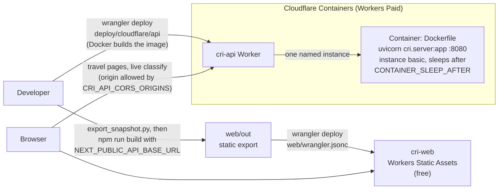

CI builds the API image and checks `/health` inside it, and type-checks the Worker,
on every pull request (`deploy-config` job). Real review data is never deployed
publicly, and is excluded from the image.

## 17. Roadmap

| Item | Description | Status |
|---|---|---|
| Real labelled evaluation | Hand-label real reviews; run `eval/predict.py` and `eval/score.py`; replace the `TBD`s | Planned |
| Clause-level gold set | Hill-destination reviews labelled per clause, to decide whether the learned backend should replace the rules | Planned |
| Public deployment | Static site in `web/` plus the API; URLs recorded in this README | Planned |
| Real travel data | Monthly arrivals to validate the demand index; onboarding of real providers and sellers with verification and accounts ([`docs/IMPLEMENTATION_PLAN.md`](docs/IMPLEMENTATION_PLAN.md)) | Planned |
| Transformer evaluation | Compare with the rule baseline on the real labelled set; make it the default only if it wins | Planned |
| Multiple changepoints | PELT or similar, once real data allows the penalty to be calibrated | Planned |

## 18. Documentation

| Document | Contents |
|---|---|
| [PRD](docs/PRD.md), [SRS](docs/SRS.md) | Product requirements; requirement IDs traced to tests |
| [SYSTEM_DESIGN](docs/SYSTEM_DESIGN.md), [API_CONTRACTS](docs/API_CONTRACTS.md) | Architecture and data flows; endpoints with real examples |
| [AI_MODEL](docs/AI_MODEL.md), [methodology](docs/methodology.md) | Every model and engine; review statistics |
| [DATA_SOURCES](docs/DATA_SOURCES.md) | Real vs SYNTHETIC vs assumption, licences, gaps |
| [BUSINESS_MODEL](docs/BUSINESS_MODEL.md) | Canvas, revenue hypotheses, impact metrics |
| [IMPLEMENTATION_PLAN](docs/IMPLEMENTATION_PLAN.md), [TODO_RESULTS](docs/TODO_RESULTS.md) | Status, limitations, next steps; every `TBD` |
| [DEMO_SCRIPT](docs/DEMO_SCRIPT.md), [DEMO](docs/DEMO.md), [DEPLOYMENT](docs/DEPLOYMENT.md) | Full demo; test-pinned G5 demo; hosting |

## 19. Contributing, conduct and security

- Contribution workflow, standards and the definition of done:
  [`CONTRIBUTING.md`](CONTRIBUTING.md)
- Community standards: [`CODE_OF_CONDUCT.md`](CODE_OF_CONDUCT.md) (Contributor
  Covenant 2.1)
- Reporting vulnerabilities privately: [`SECURITY.md`](SECURITY.md)

Maintainer: [@AnubhavKiroula](https://github.com/AnubhavKiroula). Team members and
roles: `TBD` (add before submission).

## 20. License and credits

Licensed under the [Apache License, Version 2.0](LICENSE); see also [`NOTICE`](NOTICE).
The banner and charts are original or generated by this project; no scraped photos
are used. Asset credits are recorded in [`docs/CREDITS.md`](docs/CREDITS.md).
