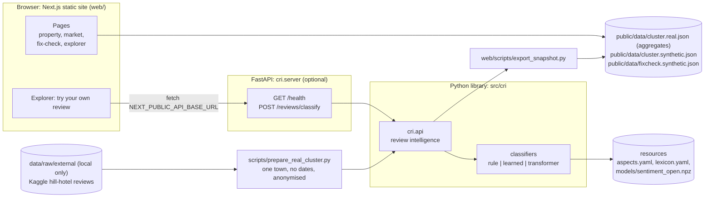
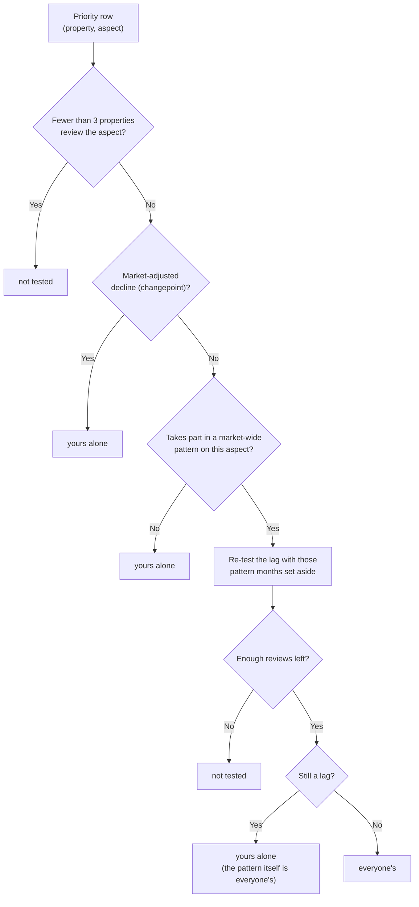

# System design

## Scope

**One user: the hotel or homestay owner.** One question, before a fix and after it:
*when my reviews get worse on an aspect, is it my problem or the whole market's?*
Answering it needs the cluster of nearby properties; one hotel's reviews cannot.

- `src/cri` is a Python library behind the `cri.api` facade.
- Next.js (`web/`, static export) is the only frontend: four pages (`/property`,
  `/market`, `/fix-check`, `/explorer`) plus home, all reading static JSON snapshots
  exported from `cri.api`:
  - the **real cluster**: 25 Kausani hotels, 2,751 TripAdvisor-derived reviews,
    aggregates only (`cluster.real.json`). Home, `/property` and `/market` lead with it;
  - the **SYNTHETIC cluster**: the simulated timeline for the method demo
    (`?source=demo` on `/property` and `/market`, and `/fix-check`), plus the
    explorer's illustrative review texts (`cluster.synthetic.json`).
- Every page header carries a provenance chip saying which of the two it shows.
- A small FastAPI service (`cri.server`) serves one feature: the explorer's live
  *Try your own review*. The site works without it.
- The same analysis also gives a tourism board a destination view
  (`destination_summary`); the earlier travel layer (`cri.travel`, its pages and
  endpoints) was removed on 2026-10-13 and is preserved at the git tag
  `travel-layer-v1`.

## Components

| Component | Responsibility | Key files |
|---|---|---|
| Review core | Ingest and validate reviews (PII dropped), normalise Hinglish/Devanagari, classify aspect+sentiment, benchmark, changepoints, market scope, priorities with *whose problem*, fix check | `src/cri/{schema,loader,sources,normalize,classify,pipeline,benchmark,changepoint,insights,intervention,api}.py` |
| Learned sentiment | Trained linear model plugged into the hybrid classifier (opt-in) | `src/cri/learned_backend.py`, `scripts/train_sentiment.py`, `scripts/prepare_region_reviews.py` |
| Real-cluster ingestion | One town's hotels in the review schema: no `date` column, anonymised `Property A..`, platform `tripadvisor` (inferred), reviewer columns never loaded; output and the id map stay local | `scripts/prepare_real_cluster.py` |
| Snapshot exporter | Dumps every page's data from `cri.api`: the real snapshot (aggregates only; kept as committed when the local input is absent), the SYNTHETIC one, and the precomputed fix-check grid | `web/scripts/export_snapshot.py` |
| HTTP API | Live classification only: input validation, CORS | `src/cri/server.py` |
| Web pages | `/property /market /fix-check /explorer` and home | `web/app/**/page.tsx` |
| Web client | `POST` helper with timeout, used only by the explorer | `web/lib/api.ts` |

**Dependency direction:** pages → snapshot ← exporter → `cri.api` → core. The
explorer's live box → API → `cri.api.classify_text`. The scoring logic lives only in
Python; TypeScript only renders it.

## Snapshots

`cluster.real.json` (real Kausani cluster) and `cluster.synthetic.json` share one
shape; the real one carries **aggregates only**.

| Key | Contents | Real | SYNTHETIC |
|---|---|---|---|
| `meta` | synthetic flag, `has_dates`, source, properties, aspects, date range (`null` without dates), review count; `provenance` (town, district, state, hotels kept / in town, reviews in town, min reviews, median reviews per hotel, platform and whether it is inferred, dataset) on the real one | yes | yes |
| `per_property` | star average, scorecard, `priority_actions` (with `whose_problem`), trends, changepoints | trends `{}`, changepoints `[]` | full |
| `market_scope` | scope per aspect with its pattern and participating properties | levels only | yes |
| `destination_summary` | cluster-wide level and negative share per aspect | yes | yes |
| `market_headline` | worst market-wide aspect by negative share, or `null` | `null` (no shared weak spot) | Room |
| `reviews`, `mentions` | raw reviews and classified clauses, for `/explorer` | **never** (TripAdvisor-derived text is not redistributed) | yes |

The site loads both at start. `fixcheck.synthetic.json` holds every "Did my fix
work?" result (property × aspect × month) and is loaded only by `/fix-check`.

## Sources without review dates

The real corpus has no review dates; none are ever filled or inferred.
`validate_reviews` accepts a frame with no `date` column and `ClusterData.has_dates`
is then False. Time-based analyses start from dated review units only, so:

- `trend`, `changepoints`, market patterns and seasonal dips return their empty typed
  frames; `intervention_check` returns verdict `no data`;
- `priority_actions` works from lag flags; `started` is always None;
- `market_scope` / `destination_summary` use **level evidence only**: a property
  flagged `lag` is `property-specific`; an aspect is `market-wide` only as a
  **shared weak spot** (`benchmark.shared_weak_spots`: the complaint share on the
  aspect exceeds the same property's other aspects, properties as replicates,
  one-sided t test, Benjamini-Hochberg, at least 60% of the properties exceeding it
  by 0.15). Nothing seasonal or step-like is ever claimed.

On Kausani no aspect is a shared weak spot; 7 of the 25 hotels lag the cluster on
at least one aspect (Room at 4, Location at 3, Cleanliness and Staff at 1 each).

## Whose problem is it? (`priority_actions.whose_problem`)

Each priority is tested **for that property**. It is never joined from
`market_scope.scope` by aspect: that label describes the cluster, not each row.

`whose_detail` states the reason. On the SYNTHETIC sample, Property F's Food decline
is *yours alone* (the market moved +0.01 while F dropped 1.22), and Property D's Room
gap is *yours alone* too: D is still 0.36 below the market outside the December dip
that all 12 properties share.

Without review dates there are no changepoints or time patterns to test, so a lag is
*yours alone* with the detail "below the cluster average; the source has no review
dates, so when it started and whether the market moved too are not tested" (real
Kausani example: Property Y, Room 0.42 and Cleanliness 0.68 below the cluster).

## Storage

- **No database.** All state is versioned files: YAML resources, the packaged model
  `.npz`, the JSON snapshots, and gitignored local data under `data/raw/`.
- The API holds no data: it builds the classifier on first use and loads no cluster.

## Design decisions and trade-offs

| Decision | Why | Trade-off |
|---|---|---|
| One user, four pages | Mentors found the earlier four-audience scope unfocused; the moat is the cluster comparison | Traveller, seller and region features are gone (recoverable from `travel-layer-v1`) |
| Static snapshot for every page | No backend to deploy or break; deep links work on any static host | Analytics changes need a re-export and commit |
| Real cluster published as aggregates only | The source is TripAdvisor-derived; we analyse it, never redistribute its text | The explorer's searchable texts stay SYNTHETIC; the real input is local, so only its owner can re-export |
| Dateless source: levels only | Dates are never invented; time claims need dates | Real pages have no trends, changepoints or time patterns; the time method is shown on the simulated timeline |
| Shared weak spot on complaint share, not mean | Neutral mentions lower a mean without anyone complaining (Kausani's Booking Experience) | Needs 10 reviews per property on each side; strict 60% participation |
| API only for live classify | Typed text must be classified by the tested Python classifier, not re-implemented in TypeScript | A second process, needed only for that box |
| *Whose problem* derived per property | A cluster-level "market-wide" label would wrongly excuse a property that lags all year | One extra benchmark re-test per lagging row in a market-wide aspect |
| Trained model opt-in, rules default | The model wins on its own domain's text but loses clause-level on the SYNTHETIC patterns (AI_MODEL.md) | The better hill-review model stays local because of data provenance |
| `.npz` model without pickle | Loading a model never executes code | Inference re-implemented in numpy, covered by a parity test |
| No auth | Demo with SYNTHETIC data only | Must be added before any real property data (SRS NFR-SEC) |

## Scalability

- **Static front end:** deploys to any CDN. The real snapshot is about 56 KB and the
  SYNTHETIC one about 2.6 MB (mostly the explorer corpus); both load once per visit,
  and the fix-check grid loads only on that page.
- **API:** stateless, one classification per request; scales horizontally.
- **When data grows:** precompute snapshots per cluster nightly, and split the
  explorer corpus out of the main snapshot before it dominates its size.
