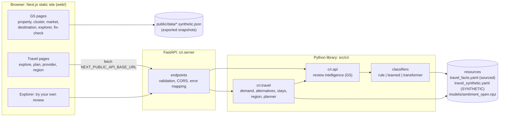
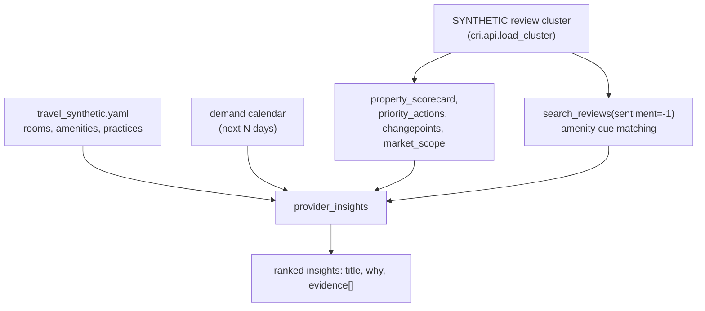
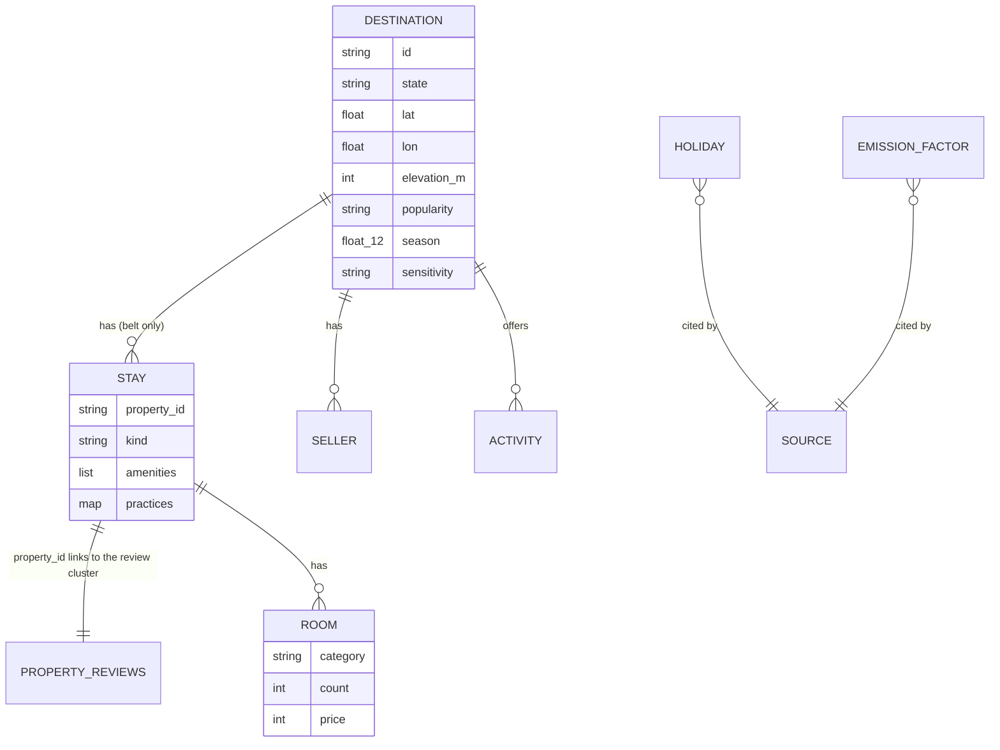

# System design

## Before and after

**Before (G5, up to `8b8dffe`):**

- `src/cri` is a Python library behind the `cri.api` facade.
- It is shown in two frontends: a Streamlit app (`app/`) and a static Next.js site
  (`web/`). The Next.js site reads a JSON snapshot exported from `cri.api`.
- There was no HTTP service, no geography and no travel features.

**Now:**

- Next.js (`web/`, static export) is the **only** frontend.
- The G5 pages still read the static snapshot. The new travel pages and live review
  classification call a **FastAPI** service (`cri.server`).
- That service wraps the review core (`cri.api`) and a new travel layer
  (`cri.travel`).
- Streamlit was removed after its two unique features were ported:
  - "Did my fix work?" became a web page (PR #31).
  - "Try your own review" moved into the web explorer.



## Components

| Component | Responsibility | Key files |
|---|---|---|
| Review core | Ingest and validate reviews (PII dropped), normalise Hinglish/Devanagari, classify aspect+sentiment, benchmark, changepoints, market scope, priorities, fix check | `src/cri/{schema,loader,sources,normalize,classify,pipeline,benchmark,changepoint,insights,intervention,api}.py` |
| Learned sentiment | Trained linear model plugged into the hybrid classifier | `src/cri/learned_backend.py`, `scripts/train_sentiment.py`, `scripts/prepare_region_reviews.py` |
| Travel data | Typed, validated loading of sourced facts and SYNTHETIC profiles; `Evidence` type carrying provenance | `src/cri/travel/data.py`, `src/cri/resources/travel_*.yaml` |
| Demand | Holiday-aware points index, long weekends, quieter dates, overview, peaks | `src/cri/travel/demand.py` |
| Alternatives | Similarity × crowd relief with capacity guard and explanations | `src/cri/travel/alternatives.py` |
| Stays | Star-free profiles; provider insights | `src/cri/travel/stays.py` |
| Region | Sellers, seller opportunity, tourism-board view | `src/cri/travel/region.py` |
| Planner | Itinerary, traced costs, carbon, variants | `src/cri/travel/planner.py` |
| HTTP API | Input validation, CORS, 404/422 mapping, JSON encoding (NaN → null) | `src/cri/server.py` |
| Web client | Typed fetch helper with timeout; travel UI components | `web/lib/api.ts`, `web/components/travel.tsx` |
| Web pages | G5: `/property /cluster /market /destination /explorer /fix-check`; travel: `/explore /plan /provider /region` | `web/app/**/page.tsx` |

**Dependency direction:** pages → API → `cri.travel` → `cri.api` → core.

- `cri.travel` never touches HTTP.
- `cri.api` knows nothing about travel.
- The scoring logic lives only in Python and is not duplicated in TypeScript.

## Data flow: demand estimate and alternatives

```mermaid
sequenceDiagram
  actor T as Traveller
  participant W as /explore (Next.js)
  participant A as cri.server
  participant D as travel.demand
  participant X as travel.alternatives
  participant R as resources
  T->>W: Mussoorie, 25 Dec 2026, 2 nights, from Delhi
  W->>A: GET /demand/trip, /demand/calendar, /alternatives, /stays
  A->>D: trip_demand(mussoorie, 2026-12-25, 2)
  D->>R: holidays (DoPT), assumed windows, season curve, tier
  D-->>A: 87/100 Very High = 30 tier + 22 season + 10 holiday + 15 long weekend + 10 year-end
  A->>X: find_alternatives(...)
  X->>D: same-date demand for every other destination
  X-->>A: ranked by similarity × min(relief, headroom); guard exclusions with reasons
  A-->>W: JSON (every number = Evidence with basis)
  W-->>T: category, factor table, quieter dates, alternatives, star-free stays
```

## Data flow: provider insights



## Storage

- **No database.** This keeps HACKATHON_PLAN's "no databases" decision.
- All state is versioned files:
  - YAML resources;
  - the packaged model `.npz`;
  - JSON snapshots for the static pages;
  - gitignored local data under `data/raw/`.
- The API holds one `ClusterData` and one `TravelData` in memory, built at start-up.
- A database becomes worthwhile when providers and sellers can edit their own
  records. That is in the roadmap (`IMPLEMENTATION_PLAN.md`).

**Entities** (logical model, held in YAML today):



## Design decisions and trade-offs

| Decision | Why | Trade-off |
|---|---|---|
| FastAPI service plus a static Next.js export | Interactive inputs (dates, budgets) must be computed live in Python, where the logic is tested. The site itself stays static and cheap to host. | Two processes to run and deploy. CORS and the API base URL are fixed at build time. |
| G5 pages keep the snapshot | They work without the API and were already built and verified. | Two data paths in one frontend. |
| Transparent points model for demand | No footfall data exists to train or validate on. | Not a forecast. Weights are assumptions, and the app says so. |
| Assumed capacity ceilings | Stops the engine from shifting pressure onto fragile places. No official caps exist. | The ceilings themselves are assumptions, shown as such. |
| Evidence objects everywhere | Every number can be traced to a fact, a measurement or a stated assumption. | Payloads are larger. |
| Trained model opt-in, rules default | The model wins on real text in its own domain but loses clause-level on the SYNTHETIC demo patterns (AI_MODEL.md). | The better model on hill reviews stays local because of data provenance. |
| `.npz` model without pickle | Loading a model never executes code. | Inference re-implemented in numpy, covered by a parity test. |
| No auth | Demo with SYNTHETIC data only. | Must be added before any real provider data (SRS NFR-SEC). |

## Scalability

- **Memory and start-up:** the API is stateless apart from the read-only data loaded at
  start-up. It scales horizontally behind a load balancer.
- **Cost per request:** the cost is per call, not per user.
  - Alternatives score 12 destinations × N nights.
  - The region view runs 12 calendars plus alternatives for overloaded places,
    around 0.3 s.
- **When data grows:**
  - Cache per-day demand (it is deterministic per date).
  - Move resources into a database with provider self-service.
  - Precompute scorecards nightly.
- **Static front end:** deploys to any CDN. The snapshot JSON is about 2.5 MB and loads
  once per visit.
